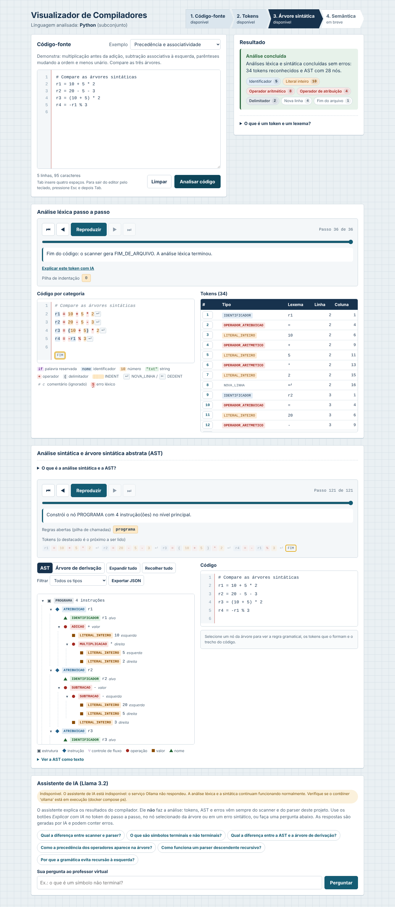
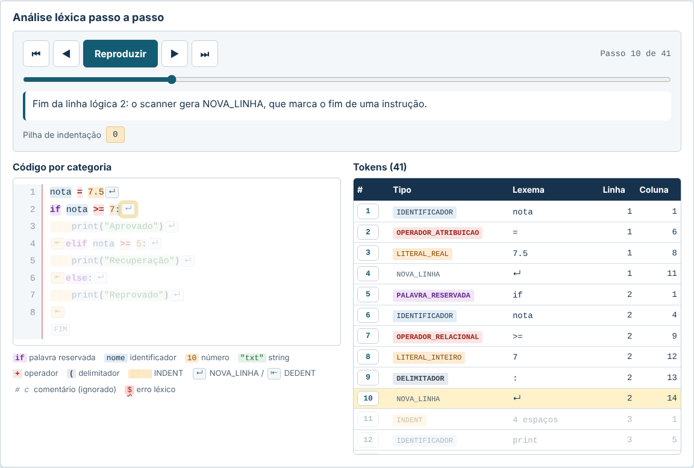
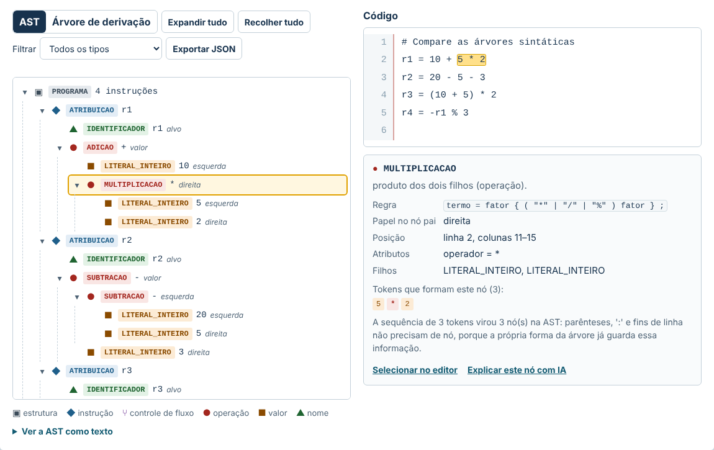

# Compiladores — Visualizador Educacional

Software educacional web para estudar as **análises léxica e sintática** com programas escritos em um subconjunto da linguagem **Python**. É voltado a estudantes de graduação em Computação que cursam a disciplina de Compiladores.

> **Etapa atual: 4 — análise sintática e árvore sintática abstrata (AST).** O estudante escreve ou escolhe um programa; o servidor o divide em **tokens** (scanner, Etapa 3) e, se não houver erro léxico, um **parser descendente recursivo** verifica a gramática e constrói a **AST**. A interface mostra a árvore navegável, a árvore de derivação, a construção passo a passo com a pilha de regras e os erros sintáticos com a regra violada. Um **assistente de IA** opcional (Ollama + Llama 3.2) explica tokens, nós e erros. A análise semântica ainda **não** existe; ela é a Etapa 5.
>
> - Primeiro uso: [`docs/tutorial.md`](docs/tutorial.md)
> - Gramática (EBNF), precedência e construções: [`docs/gramatica.md`](docs/gramatica.md)
> - Escopo léxico (categorias, decisões e erros): [`docs/escopo-lexico.md`](docs/escopo-lexico.md)
> - Proposta e seção Materiais e Métodos do artigo (escopo, arquitetura, fluxograma, critérios): [`docs/materiais-e-metodos.md`](docs/materiais-e-metodos.md)
> - Casos de teste documentados (CT-01 a CT-45): [`docs/casos-de-teste.md`](docs/casos-de-teste.md)
> - Plano de avaliação e formulário da avaliação por pares: [`docs/plano-de-avaliacao.md`](docs/plano-de-avaliacao.md)
> - **Avalie o sistema (questionário anônimo):** https://forms.gle/Rew1G5XDrc7Gd8Dw8
> - Definição do problema e revisão de literatura: [`docs/revisao-literatura.md`](docs/revisao-literatura.md)



## Sumário

1. [Objetivo](#1-objetivo)
2. [Linguagem escolhida e subconjunto](#2-linguagem-escolhida-e-subconjunto)
3. [Tecnologias](#3-tecnologias)
4. [Estrutura do repositório](#4-estrutura-do-repositório)
5. [Pré-requisitos](#5-pré-requisitos)
6. [Como executar e acessar](#6-como-executar-e-acessar)
7. [Como encerrar](#7-como-encerrar)
8. [Usando a interface](#8-usando-a-interface)
9. [Exemplos disponíveis](#9-exemplos-disponíveis)
10. [Comunicação entre frontend e backend](#10-comunicação-entre-frontend-e-backend)
11. [Testes](#11-testes)
12. [Limitações conhecidas](#12-limitações-conhecidas)
13. [Histórico das etapas](#13-histórico-das-etapas)
14. [Analisador léxico (Etapa 3)](#14-analisador-léxico-etapa-3)
15. [Analisador sintático e AST (Etapa 4)](#15-analisador-sintático-e-ast-etapa-4)
16. [Assistente de IA: Ollama e Llama 3.2 (diferencial)](#16-assistente-de-ia-ollama-e-llama-32-diferencial)

---

## 1. Objetivo

Ajudar estudantes a compreender como um compilador lê um programa, mostrando passo a passo o reconhecimento de tokens por autômatos finitos e a construção da árvore sintática, a partir de um código que o próprio estudante escreve. A ferramenta usa Python porque muitos alunos já conhecem a linguagem, o que permite concentrar o esforço nos conceitos de compilação.

## 2. Linguagem escolhida e subconjunto

### Por que Python

| Motivo | Explicação |
| --- | --- |
| Familiaridade | É a linguagem com que muitos alunos começam a graduação; o estudante analisa um código que já sabe ler. |
| Sintaxe enxuta | Permite definir um subconjunto pequeno sem perder realismo. |
| Desafio léxico próprio | A indentação gera os tokens `INDENT` e `DEDENT`, conceito ausente em linguagens delimitadas por chaves e pouco explorado nas ferramentas existentes. |
| Validação | Os módulos nativos `tokenize` e `ast` servem de oráculo nos testes: o scanner é comparado ao `tokenize` e o parser ao `ast`, em programas fixos e em 300 programas aleatórios cada. |

### Subconjunto

O projeto **não** cobre o Python inteiro. O scanner (Etapa 3) e o parser (Etapa 4) tratam o subconjunto abaixo. A tabela de escopo léxico está na [seção 14](#14-analisador-léxico-etapa-3), e a gramática formal em EBNF está em [`docs/gramatica.md`](docs/gramatica.md).

| Categoria | Construções incluídas | Exemplo |
| --- | --- | --- |
| Literais | Inteiros, números de ponto flutuante, strings entre aspas, `True`, `False` | `42`, `3.14`, `"oi"` |
| Identificadores e atribuição | Nomes de variáveis e atribuição simples | `x = 10` |
| Operadores aritméticos | `+`, `-`, `*`, `/`, `%` e parênteses | `(a + b) * 2` |
| Operadores relacionais | `==`, `!=`, `<`, `<=`, `>`, `>=` | `x >= 0` |
| Condicional | `if` / `elif` / `else` com blocos indentados | `if x > 0:` |
| Repetição | `while` com bloco indentado | `while i < 10:` |
| Chamadas de função | `print(...)` e outras chamadas, como instrução ou dentro de expressões | `print(x, "ok")` |
| Estrutura de bloco | Tokens `NOVA_LINHA`, `INDENT`, `DEDENT` e comentários `#` | — |

**Fora do escopo:** funções (`def`), `for`, listas, dicionários, classes, `import`, operadores lógicos (`and`, `or`, `not`), comparações encadeadas (`0 < x < 10`) e atribuições múltiplas. Cada um gera um erro que explica por que não faz parte do subconjunto ([`docs/gramatica.md`](docs/gramatica.md#5-construções-suportadas-e-fora-do-escopo)).

## 3. Tecnologias

| Parte | Tecnologia | Observação |
| --- | --- | --- |
| Frontend | HTML, CSS e JavaScript (módulos ES, sem etapa de build) | Servido pelo **Nginx 1.27** |
| Backend | **Python 3.12** com **Starlette 1.6** e **Uvicorn 0.53** | Na Etapa 2 a API passou de FastAPI para Starlette, a base do próprio FastAPI, por ser mais leve; o contrato da Etapa 1 foi mantido |
| Orquestração | **Docker Compose** | Serviços `frontend`, `backend` e `ollama`, mais o perfil `testes` |
| Análise léxica e sintática | Código próprio em Python (scanner e parser descendente recursivo escritos à mão) | Nenhum gerador de analisadores; veja as seções 14 e 15 |
| Assistente de IA (opcional) | **Ollama** (imagem `ollama/ollama:latest`) com o modelo **Llama 3.2** (3B) | Acessado só pelo backend, pela API HTTP do Ollama; veja a seção 16 |
| Testes do backend | `unittest` (biblioteca padrão do Python) | Sem dependências extras |
| Testes do frontend | `node --test` (Node.js 22) | Sem dependências extras |
| Testes de interface e ponta a ponta | **Playwright 1.56** (Python) com Chromium | Imagem `tests/e2e/Dockerfile`, baseada na oficial `mcr.microsoft.com/playwright/python:v1.56.0-noble` |

Não há banco de dados: o projeto ainda não precisa guardar informações.

## 4. Estrutura do repositório

```
compiladores/
├── backend/
│   ├── app/
│   │   ├── main.py            # rotas da API e tratamento de erros
│   │   ├── scanner.py         # analisador léxico (Etapa 3)
│   │   ├── parser.py          # analisador sintático, AST e gramática (Etapa 4)
│   │   ├── ia.py              # assistente de IA: comunicação com o Ollama
│   │   ├── demo_ia.py         # demonstração com o Llama 3.2 (scripts/testar-ia)
│   │   └── validacao.py       # regras de validação da entrada (sem dependência do framework)
│   ├── tests/
│   │   ├── cliente_asgi.py    # cliente HTTP em processo para os testes
│   │   ├── test_api.py        # testes dos endpoints
│   │   ├── test_scanner.py    # testes unitários do scanner e comparação com o tokenize
│   │   ├── test_parser.py     # testes do parser e comparação com o módulo ast
│   │   ├── test_ia.py         # testes do assistente com um Ollama falso
│   │   └── test_validacao.py  # testes unitários das regras
│   ├── Dockerfile
│   └── requirements.txt
├── frontend/
│   ├── index.html             # tela principal
│   ├── css/estilo.css
│   ├── js/
│   │   ├── app.js             # ponto de entrada
│   │   ├── interface.js       # liga a tela ao comportamento (tabela, cores, passo a passo)
│   │   ├── lexico.js          # prepara os tokens para exibição (sem acesso ao DOM)
│   │   ├── sintatico.js       # prepara a AST e os erros para exibição (sem acesso ao DOM)
│   │   ├── painel-sintatico.js # árvore navegável, derivação e passo a passo do parser
│   │   ├── assistente-ia.js   # painel do assistente de IA
│   │   ├── api.js             # comunicação com o backend
│   │   ├── validacao.js       # validação no navegador
│   │   └── exemplos.js        # programas de exemplo
│   ├── tests/unit/            # testes unitários (node --test)
│   ├── nginx.conf             # serve o frontend e repassa /api/ ao backend
│   ├── package.json
│   └── Dockerfile
├── tests/e2e/
│   ├── test_interface.py      # testes de interface e ponta a ponta (Playwright)
│   ├── servidor_local.py      # frontend + backend juntos para testar sem Docker
│   └── Dockerfile             # imagem dos testes de interface
├── scripts/
│   ├── testar.ps1             # roda todos os testes no Docker (Windows)
│   ├── testar.sh              # idem (Linux/macOS)
│   ├── testar-ia.ps1          # valida o assistente com o Llama 3.2 de verdade (Windows)
│   ├── testar-ia.sh           # idem (Linux/macOS)
│   └── casos_de_teste.py      # gera docs/casos-de-teste.md a partir do JSON dos casos
├── docs/
│   ├── gramatica.md           # gramática EBNF, precedência, construções e exemplos
│   ├── materiais-e-metodos.md # seção 3 do artigo: proposta, arquitetura, fluxo, critérios, avaliação
│   ├── casos-de-teste.md      # CT-01 a CT-45 (gerado de backend/tests/casos_de_teste.json)
│   ├── plano-de-avaliacao.md  # roteiro de tarefas e formulário (Likert 1–5)
│   ├── figuras/               # fluxograma e diagrama de componentes (Mermaid, SVG, PNG)
│   ├── escopo-lexico.md       # categorias de token, decisões e erros léxicos
│   ├── tutorial.md            # roteiro de primeiro uso
│   ├── testes.md              # registro das execuções de teste
│   ├── interface/             # capturas de tela da interface
│   ├── validacao/             # evidências das validações no Docker
│   └── revisao-literatura.md
├── docker-compose.yml
└── README.md
```

## 5. Pré-requisitos

| Ferramenta | Versão mínima | Como verificar |
| --- | --- | --- |
| Git | 2.30 | `git --version` |
| Docker Engine (ou Docker Desktop) | 24.0 | `docker --version` |
| Docker Compose (plugin v2) | 2.20 | `docker compose version` |

A porta **8080** precisa estar livre. Não é necessário instalar Python nem Node.js: tudo, inclusive os testes, roda em contêineres. Na primeira execução, o Docker baixa as imagens do Node, do Playwright e do Ollama (cerca de 4 GB no total).

O assistente de IA é opcional. Para usá-lo, o modelo Llama 3.2 (cerca de 2 GB) precisa ser baixado uma vez para o volume `ollama_data` (seção 16). Ele roda no processador; recomenda-se ter pelo menos 8 GB de RAM livres. Sem o modelo, todo o resto funciona normalmente.

> No Windows e no macOS, instale o [Docker Desktop](https://www.docker.com/products/docker-desktop/), que já inclui o Docker Compose. No Linux, instale o [Docker Engine](https://docs.docker.com/engine/install/) e o plugin `docker-compose-plugin`.

## 6. Como executar e acessar

```bash
git clone https://github.com/HenriqueNeuhaus/compiladores.git
cd compiladores
docker compose up --build -d --wait
```

O `--wait` faz o comando só terminar quando o backend e o frontend estiverem saudáveis. Depois, abra **http://localhost:8080** no navegador.

Para conferir pelo terminal:

```bash
docker compose ps                               # backend e frontend como "healthy", ollama "running"
curl http://localhost:8080/api/health            # {"status":"ok","versao":"0.4.0"}
docker compose exec ollama ollama pull llama3.2  # opcional: baixa o modelo do assistente (uma vez)
```

No PowerShell do Windows, use `curl.exe` no lugar de `curl`.

## 7. Como encerrar

```bash
docker compose down              # para e remove os contêineres e a rede
docker compose down --rmi local  # também remove as imagens construídas pelo projeto
```

## 8. Usando a interface

Um roteiro guiado, com exercícios, está em [`docs/tutorial.md`](docs/tutorial.md).

| Elemento | O que faz |
| --- | --- |
| Cabeçalho | Mostra o nome do sistema, a linguagem analisada (Python, subconjunto) e as fases do compilador. **Código-fonte**, **Tokens** e **Árvore sintática** estão disponíveis; **Semântica** aparece como "em breve". |
| **Exemplo** | Lista os programas prontos. Ao escolher um, o código **substitui** o conteúdo do editor e uma linha explica o que ele demonstra. O código carregado pode ser editado. |
| Editor de código | Fonte monoespaçada e numeração de linhas. **Tab** insere quatro espaços; para sair do editor pelo teclado, pressione **Esc** e depois **Tab**. Abaixo há um contador de linhas e caracteres. |
| **Analisar código** | Envia o código ao backend. Durante o envio o botão fica desabilitado e mostra "Analisando…". |
| **Limpar** | Esvazia o editor, o resultado e a análise. |
| **Resultado** | Antes da primeira análise, mostra o tutorial "Como usar". Depois, mostra o resumo das duas fases, a **contagem de tokens por categoria**, a lista de **erros léxicos** e de **avisos** e a lista de **erros sintáticos** (com o selo "Erro sintático", o que foi encontrado, o que era esperado e a regra da gramática). Cada item tem o botão **Mostrar no código**, que seleciona o trecho no editor. |
| **O que é um token e um lexema?** | Explicação curta dos conceitos, que pode ser aberta e fechada. |
| **Análise sintática e AST** | Aparece depois da análise, abaixo da léxica. Tem a explicação "O que é a análise sintática e a AST?", o **reprodutor do parser** (pilha de regras abertas, fita de tokens com o próximo a ser lido e a frase que explica cada decisão; os nós ainda não construídos ficam esmaecidos), a **árvore navegável** (AST ou árvore de derivação, expandir e recolher tudo, teclado com setas, filtro por tipo de nó e **Exportar JSON**) e o painel do **nó selecionado**: trecho destacado no código, regra EBNF, papel no nó pai, posição, atributos, filhos e os tokens que formam o nó. Com erro sintático, a AST não é construída e o painel explica por quê; com erro léxico, o parser não é executado e o painel informa o motivo. |
| **Assistente de IA** | Professor virtual com perguntas sugeridas e campo livre, além dos botões **Explicar este token com IA** (passo a passo léxico), **Explicar este nó com IA** (nó selecionado) e **Entender erro com IA** (erro sintático). As respostas aparecem com o selo "Gerado por IA", o aviso de que podem conter erros e os dados do compilador enviados ao modelo. |
| **Análise léxica passo a passo** | Aparece depois da análise. Tem o **código colorido por categoria** (com `↵` para `NOVA_LINHA` e `⇤` para `DEDENT`), a **tabela de tokens** (#, tipo, lexema, linha, coluna) e o **reprodutor**: primeiro, anterior, reproduzir/pausar, próximo e último passo, barra deslizante, setas do teclado, explicação de cada decisão do scanner e a pilha de indentação. Os tokens ainda não lidos ficam esmaecidos. Clicar (ou tocar) em um token do código ou no número dele na tabela leva ao passo correspondente. Se o código for editado depois da análise, um aviso pede para analisar de novo. |

A página funciona em telas de celular (a partir de 360 px) sem rolagem horizontal; a tabela e o código têm rolagem própria e os botões do reprodutor têm pelo menos 40 px de altura para toque.





### Mensagens apresentadas

| Situação | Onde é detectada | Mensagem |
| --- | --- | --- |
| Editor vazio | Navegador (e backend) | Informe um código-fonte antes de solicitar a análise. |
| Só espaços ou quebras de linha | Navegador (e backend) | O código informado contém apenas espaços ou quebras de linha. Escreva um programa ou escolha um exemplo. |
| Mais de 20 000 caracteres | Navegador (e backend) | O código informado ultrapassa o limite de 20000 caracteres. |
| Requisição fora do contrato | Backend | Mensagem específica do problema (JSON inválido, campo ausente etc.) |
| Servidor fora do ar, rede indisponível ou mais de 10 s sem resposta | Navegador | Não foi possível comunicar com o servidor. Verifique a conexão e tente novamente. |
| Erro inesperado no servidor | Backend e navegador | Ocorreu um erro inesperado ao processar a solicitação. Tente novamente. |
| Código sem erros léxicos | Scanner | Análise léxica concluída sem erros: N tokens reconhecidos. |
| Código com erros léxicos | Scanner | Análise léxica concluída com N erro(s) léxico(s) encontrado(s). Os trechos válidos foram reconhecidos como M tokens. A análise sintática não foi executada. Em seguida, uma mensagem por erro, por exemplo: *Erro léxico na linha 3, coluna 19: caractere não reconhecido '$'. Verifique se ele faz parte do subconjunto suportado.* |
| Código válido | Scanner e parser | Análises léxica e sintática concluídas sem erros: N tokens reconhecidos e AST com M nós. |
| Código com erros sintáticos | Parser | Análise léxica concluída sem erros (N tokens), mas a análise sintática encontrou K erro(s) sintático(s). Em seguida, uma mensagem por erro, por exemplo: *Erro sintático na linha 2, coluna 9: era esperado ':' no fim da linha do if, mas foi encontrado o fim da linha. Em Python, toda linha que abre um bloco (if, elif, else, while) termina com dois-pontos.* |

O resultado sem erros aparece em verde; erros léxicos, falhas de comunicação e erros inesperados, em vermelho; erros sintáticos, em roxo e com o selo "Erro sintático" (a cor não é a única pista); problemas na entrada, em amarelo. Nenhuma mensagem expõe rastreamentos, caminhos internos ou variáveis do servidor.

## 9. Exemplos disponíveis

| Exemplo | O que demonstra | Resultado |
| --- | --- | --- |
| Atribuição e expressões aritméticas | Atribuição, números inteiros e reais, operadores `+ - * /`, parênteses, comentário e `print` | 35 tokens; AST com 23 nós |
| Estrutura condicional | `if`, `elif` e `else`, operadores relacionais, strings e blocos indentados (`INDENT`/`DEDENT`) | 41 tokens; AST com 21 nós |
| Repetição com blocos aninhados | `while`, `if` dentro de `while`, operador `%`, comparação `==` e vários níveis de indentação | 51 tokens; AST com 34 nós |
| Precedência e associatividade | `10 + 5 * 2`, `20 - 5 - 3`, `(10 + 5) * 2` e menos unário, para comparar as árvores | sem erros |
| Erro sintático (tokens válidos) | `if` sem os dois-pontos: todos os tokens são válidos, mas o parser recusa | 0 erros léxicos; 1 erro sintático |
| Erros sintáticos (vários) | operador sem operando, `:` ausente, `elif` sem condição e atribuição a um literal; o parser se recupera | 4 erros sintáticos |
| Erros léxicos | Identificador com acento, caractere `$`, string sem fechar e operador `//`; o scanner continua depois de cada erro | 5 erros léxicos; parser não executado |

O código de cada exemplo está em [`frontend/js/exemplos.js`](frontend/js/exemplos.js).

## 10. Comunicação entre frontend e backend

O navegador sempre chama a API no mesmo endereço da página (`/api/...`). O Nginx do contêiner `frontend` repassa essas requisições para `http://backend:8000`, nome que só existe dentro da rede do Docker. Assim, o navegador nunca precisa conhecer o endereço interno do backend.

```
Navegador ──► frontend (Nginx, porta 8080) ──/api/──► backend (Starlette, porta 8000) ──► ollama (porta 11434, só na rede interna)
```

Dentro do backend, o fluxo de `POST /api/analisar` é: validar a entrada → scanner (tokens e erros léxicos) → se não houver erro léxico, parser (verifica a gramática e constrói a AST) → resposta com os resultados das duas fases.

### `POST /api/analisar`

Requisição (`Content-Type: application/json`):

```json
{ "codigo": "x = 10\nprint(x)" }
```

A resposta mantém **todos os campos da Etapa 3 no mesmo lugar** (compatibilidade) e acrescenta dois objetos: `lexico` (o resultado léxico agrupado) e `sintatico` (o resultado do parser). Os campos da Etapa 3 vêm primeiro, abaixo; `lexico` e `sintatico` estão descritos logo depois.

Resposta **200** (a análise rodou). Campos da Etapa 3 para `if x >= 1:\n    print("oi")  # saudação\n`, com listas encurtadas:

```json
{
  "recebido": true,
  "mensagem": "Análise léxica concluída sem erros: 14 tokens reconhecidos.",
  "estatisticas": { "linhas": 2, "caracteres": 39 },
  "sucesso": true,
  "tokens": [
    { "tipo": "PALAVRA_RESERVADA", "lexema": "if", "linha": 1, "coluna": 1,
      "linha_final": 1, "coluna_final": 2, "fora_do_subconjunto": false },
    { "tipo": "IDENTIFICADOR", "lexema": "x", "linha": 1, "coluna": 4,
      "linha_final": 1, "coluna_final": 4, "fora_do_subconjunto": false },
    { "tipo": "OPERADOR_RELACIONAL", "lexema": ">=", "linha": 1, "coluna": 6,
      "linha_final": 1, "coluna_final": 7, "fora_do_subconjunto": false },
    "...",
    { "tipo": "INDENT", "lexema": "    ", "linha": 2, "coluna": 1,
      "linha_final": 2, "coluna_final": 4, "fora_do_subconjunto": false },
    "...",
    { "tipo": "DEDENT", "lexema": "", "linha": 3, "coluna": 1,
      "linha_final": 3, "coluna_final": 0, "fora_do_subconjunto": false },
    { "tipo": "FIM_DE_ARQUIVO", "lexema": "", "linha": 3, "coluna": 1,
      "linha_final": 3, "coluna_final": 0, "fora_do_subconjunto": false }
  ],
  "erros": [],
  "avisos": [],
  "comentarios": [ { "lexema": "# saudação", "linha": 2, "coluna": 18, "coluna_final": 27 } ],
  "contagem": { "PALAVRA_RESERVADA": 1, "IDENTIFICADOR": 2, "LITERAL_INTEIRO": 1, "LITERAL_REAL": 0,
                "LITERAL_STRING": 1, "OPERADOR_ARITMETICO": 0, "OPERADOR_RELACIONAL": 1,
                "OPERADOR_ATRIBUICAO": 0, "DELIMITADOR": 3, "NOVA_LINHA": 2, "INDENT": 1,
                "DEDENT": 1, "FIM_DE_ARQUIVO": 1 },
  "passos": [
    { "indice": 0, "tipo": "token", "token": 0, "linha": 1, "coluna": 1, "linha_final": 1,
      "coluna_final": 2, "pilha": [0],
      "descricao": "Leu 'if': tem a forma de um identificador, mas está na lista de palavras reservadas → PALAVRA_RESERVADA." },
    "..."
  ]
}
```

| Campo | Significado |
| --- | --- |
| `recebido`, `estatisticas` | Mantidos da Etapa 2 (compatibilidade). |
| `mensagem` | Resumo das análises léxica e sintática, pronto para exibir (na Etapa 3 resumia só a léxica; o resumo léxico continua em `lexico.mensagem`). |
| `sucesso` | `true` se não houve erro léxico (avisos não contam). |
| `tokens` | Tokens em ordem. Linhas e colunas começam em 1; `coluna_final` é a coluna do último caractere (tokens sem texto têm `coluna_final = coluna - 1`). `fora_do_subconjunto` marca palavras reservadas de Python que o subconjunto não aceita. |
| `erros` | Erros léxicos: `tipo` (`ERRO_LEXICO`), `codigo` (ver [`docs/escopo-lexico.md`](docs/escopo-lexico.md#3-erros-e-avisos-léxicos)), `lexema`, posição inicial e final e `mensagem`. |
| `avisos` | Mesmo formato, com `tipo` igual a `AVISO`. |
| `comentarios` | Comentários lidos e descartados. |
| `contagem` | Quantidade de tokens por categoria (as 13 categorias sempre aparecem). |
| `passos` | Uma entrada por decisão do scanner, em ordem: `tipo` (`token`, `erro` ou `ignorado`), `descricao`, posição, pilha de indentação naquele momento e o índice do `token` ou do `erro` correspondente. |

Com erro léxico a resposta continua **200**, com `sucesso: false`, porque o problema está no programa analisado e não na requisição. Exemplo para `x = 1 $ 2`:

```json
{
  "sucesso": false,
  "mensagem": "Análise léxica concluída com 1 erro léxico encontrado. Os trechos válidos foram reconhecidos como 6 tokens.",
  "erros": [
    { "tipo": "ERRO_LEXICO", "codigo": "caractere_nao_reconhecido", "lexema": "$",
      "linha": 1, "coluna": 7, "linha_final": 1, "coluna_final": 7,
      "mensagem": "Erro léxico na linha 1, coluna 7: caractere não reconhecido '$'. Verifique se ele faz parte do subconjunto suportado." }
  ],
  "...": "demais campos como no exemplo anterior"
}
```

#### Campos da Etapa 4: `lexico` e `sintatico`

Programa válido, `resultado = 10 + 5 * 2` (listas encurtadas):

```json
{
  "mensagem": "Análises léxica e sintática concluídas sem erros: 9 tokens reconhecidos e AST com 8 nós.",
  "lexico": { "sucesso": true, "mensagem": "Análise léxica concluída sem erros: 9 tokens reconhecidos.",
              "tokens": ["..."], "erros": [], "avisos": [] },
  "sintatico": {
    "executado": true,
    "sucesso": true,
    "ast": {
      "id": 0, "tipo": "PROGRAMA", "regra": "programa", "papel": null,
      "linha": 1, "coluna": 1, "linha_final": 2, "coluna_final": 0,
      "atributos": { "instrucoes": 1 }, "passo": 30,
      "filhos": [ { "id": 1, "tipo": "ATRIBUICAO", "atributos": { "nome": "resultado" }, "filhos": ["..."] } ]
    },
    "derivacao": { "regra": "programa", "filhos": ["..."] },
    "erros": [],
    "contagem_nos": { "PROGRAMA": 1, "ATRIBUICAO": 1, "IDENTIFICADOR": 1, "ADICAO": 1,
                      "LITERAL_INTEIRO": 3, "MULTIPLICACAO": 1 },
    "passos": [
      { "indice": 5, "tipo": "consumir", "regra": "atribuicao", "token": 1, "linha": 1, "coluna": 11,
        "pilha": ["programa", "instrucao", "atribuicao"],
        "descricao": "Consome '=' (OPERADOR_ATRIBUICAO), esperado pela regra atribuicao." },
      "..."
    ],
    "passos_truncados": false,
    "gramatica": { "programa": "programa = { instrucao } FIM_DE_ARQUIVO ;", "...": "..." }
  }
}
```

Formato de **todo** nó da AST (o mesmo para todos os tipos). Exemplo: o nó `MULTIPLICACAO` de `5 * 2`:

```json
{ "id": 5, "tipo": "MULTIPLICACAO", "regra": "termo", "papel": "direita",
  "linha": 1, "coluna": 18, "linha_final": 1, "coluna_final": 22,
  "atributos": { "operador": "*" }, "passo": 25,
  "filhos": [
    { "id": 6, "tipo": "LITERAL_INTEIRO", "regra": "primario", "papel": "esquerda", "linha": 1, "coluna": 18,
      "linha_final": 1, "coluna_final": 18, "atributos": { "valor": "5" }, "passo": 19, "filhos": [] },
    { "id": 7, "tipo": "LITERAL_INTEIRO", "regra": "primario", "papel": "direita", "linha": 1, "coluna": 22,
      "linha_final": 1, "coluna_final": 22, "atributos": { "valor": "2" }, "passo": 24, "filhos": [] } ] }
```

| Campo de `sintatico` | Significado |
| --- | --- |
| `executado` | `false` quando há erro léxico (o parser não roda; veja `motivo`). |
| `sucesso` | `true` se o parser não encontrou erro sintático. |
| `ast` | Raiz da AST (`PROGRAMA`), ou `null` se houve erro. Cada nó tem `id` (pré-ordem), `tipo`, `regra` (a regra da gramática que o construiu), `papel` (o que ele é para o pai: `condição`, `valor`, `esquerda`…), posição inicial e final, `atributos`, `passo` (em que passo foi construído) e `filhos`. Os tipos estão na seção 15. |
| `derivacao` | Árvore de derivação (concreta): nós `{regra, filhos}` e folhas `{terminal, lexema, linha, coluna}`; `null` se houve erro. |
| `erros` | Erros sintáticos (formato abaixo). |
| `contagem_nos` | Quantidade de nós por tipo. |
| `passos` | Decisões do parser em ordem: `tipo` (`entrar`, `consumir`, `construir`, `erro` ou `recuperar`), `descricao`, `regra`, `pilha` de regras abertas e `token` (índice do próximo token). Limitados a 20 000 (`passos_truncados`). |
| `gramatica` | As 15 produções EBNF, para a interface mostrar a regra de cada nó e de cada erro. |
| `motivo` | Só quando `executado` é `false`: por que o parser não rodou. |

Resposta com **erro sintático**, `x = 5 + * 2` (a resposta continua **200**: o problema está no programa, não na requisição):

```json
{
  "mensagem": "Análise léxica concluída sem erros (8 tokens), mas a análise sintática encontrou 1 erro sintático.",
  "lexico": { "sucesso": true, "...": "..." },
  "sintatico": {
    "executado": true, "sucesso": false, "ast": null, "derivacao": null,
    "erros": [ {
      "tipo": "ERRO_SINTATICO", "codigo": "operadores_consecutivos",
      "linha": 1, "coluna": 9, "linha_final": 1, "coluna_final": 9,
      "encontrado": "*", "encontrado_tipo": "OPERADOR_ARITMETICO", "esperado": ["expressao"],
      "regra": "soma", "producao": "soma = termo { ( \"+\" | \"-\" ) termo } ;",
      "mensagem": "Erro sintático na linha 1, coluna 9: dois operadores seguidos: '+' e '*'. Depois de '+' era esperado um valor (número, nome ou expressão entre parênteses)."
    } ],
    "passos": ["..."]
  }
}
```

Resposta com **erro léxico**, `x = 1 $ 2`: os campos léxicos aparecem como na Etapa 3 e o parser não é executado.

```json
{ "sucesso": false, "erros": [ { "tipo": "ERRO_LEXICO", "...": "..." } ],
  "sintatico": { "executado": false, "sucesso": false, "ast": null, "erros": [],
                 "motivo": "A análise sintática não foi executada porque o código tem 1 erro léxico. Corrija-os primeiro: com tokens faltando, o parser apontaria erros que não existem." } }
```

Respostas de erro, sempre no mesmo formato:

```json
{ "recebido": false, "erro": { "tipo": "entrada_vazia", "mensagem": "Informe um código-fonte antes de solicitar a análise." } }
```

| Código HTTP | `erro.tipo` | Quando ocorre |
| --- | --- | --- |
| 400 | `json_invalido` | Corpo vazio, que não é JSON ou que não está em UTF-8 |
| 400 | `entrada_vazia` | `codigo` é um texto vazio |
| 400 | `entrada_em_branco` | `codigo` tem só espaços, tabulações ou quebras de linha |
| 413 | `entrada_muito_grande` | `codigo` com mais de 20 000 caracteres |
| 422 | `corpo_nao_objeto` | O JSON não é um objeto (por exemplo, uma lista) |
| 422 | `campo_ausente` | Falta o campo `codigo` |
| 422 | `tipo_invalido` | `codigo` não é texto (número, nulo, lista…) |
| 404 | `rota_inexistente` | Endereço da API que não existe |
| 405 | `metodo_nao_permitido` | Método errado, por exemplo `GET /api/analisar` |
| 500 | `erro_interno` | Erro inesperado; o detalhe fica só no log do servidor |

### Outros endpoints

| Endpoint | Resposta | Uso |
| --- | --- | --- |
| `GET /api/health` | `{"status": "ok", "versao": "0.4.0"}` | Healthcheck do Docker Compose |
| `GET /api/ia/status` | `{"disponivel": true, "modelo": "llama3.2", "modelo_instalado": true, "mensagem": null}` | Interface avisa se o assistente de IA está disponível (seção 16) |
| `POST /api/ia/explicar` | Explicação gerada pelo Llama 3.2 | Assistente de IA (seção 16) |
| `GET /api/hello` | `{"message": "Hello, World!"}` | Mantido da Etapa 1, por compatibilidade |

## 11. Testes

Os testes cresceram junto com cada funcionalidade e cobrem estes níveis:

| Tipo | O que verifica | Ferramenta | Arquivos | Quantidade |
| --- | --- | --- | --- | --- |
| Unitário do parser | Cada construção válida e a AST esperada; precedência e associatividade (`2 + 3 * 4`, `10 - 3 - 2`, `(10 + 5) * 2`, menos unário); aninhamento; construções incompletas; combinações inválidas; posições de nós e erros; campos `encontrado`/`esperado`/`regra`; recuperação de erros; casos de borda (vazio, só comentários, um comando, fim no meio, aninhamento excessivo, programa grande); integração com o scanner; árvore de derivação; gramática do código igual à de `docs/gramatica.md`; **comparação com o módulo `ast` do Python** (estrutura e posições) em programas de referência e em 300 programas aleatórios | `unittest` | `backend/tests/test_parser.py` | 72 |
| Unitário do scanner | Palavras reservadas, identificadores, literais, operadores simples e compostos, delimitadores, comentários, espaços, indentação, posições, cada erro léxico, casos de borda e comparação com o `tokenize` do Python em 300 programas aleatórios | `unittest` | `backend/tests/test_scanner.py` | 58 |
| Casos documentados | Os 45 casos CT-01 a CT-45 de `docs/casos-de-teste.md` (válidos, erros léxicos, sintáticos, casos de borda); os 5 semânticos previstos só verificam a parte léxica e sintática até a Etapa 5 (teste ignorado) | `unittest` | `backend/tests/test_casos_de_teste.py` + `casos_de_teste.json` | 5 (1 ignorado) |
| Unitário (backend) | Regras de validação e estatísticas | `unittest` | `backend/tests/test_validacao.py` | 20 |
| Endpoints (backend) | Contrato com os campos da Etapa 3 preservados e `lexico`/`sintatico`; AST e sucesso para código válido; erros e AST nula para erro sintático; parser não executado com erro léxico; códigos HTTP; entrada vazia; falhas do scanner ou do parser como 500 genérico; entrada no limite; regressão das Etapas 1 a 3 | `unittest` | `backend/tests/test_api.py` | 36 |
| Assistente de IA (backend) | Comunicação com um Ollama falso (`/api/chat` e `/api/tags`), extração de `message.content`, resposta vazia ou inválida, modelo não baixado, indisponibilidade com nova tentativa, tempo limite, contexto montado a partir do scanner e do parser, dados delimitados contra injeção, pedidos inválidos, análise funcionando sem a IA | `unittest` | `backend/tests/test_ia.py` | 21 |
| Unitário (frontend) | Validação, exemplos, cliente da API (inclusive o do assistente) e preparação dos tokens e da AST para exibição | `node --test` | `frontend/tests/unit/*.test.js` | 74 |
| Interface e ponta a ponta | Etapas 2 e 3 (tela, edição, exemplos, envio, mensagens, tabela, cores, passo a passo léxico, celular) e Etapa 4: árvore para código válido, precedência e parênteses na árvore, seleção de nó com trecho e regra, posições iguais às da tabela de tokens, expandir/recolher e teclado, filtro, exportação JSON, árvore de derivação, passo a passo do parser, erros sintáticos com encontrado/esperado/regra, vários erros, distinção entre erro léxico e sintático, entradas grandes e estranhas, celular, assistente de IA simulado | Playwright | `tests/e2e/test_interface.py` | 77 |
| Implantação | Build das imagens e healthcheck dos serviços | Docker Compose (`--wait`) | `docker-compose.yml` | — |
| Assistente com o modelo real | Ollama no ar, modelo instalado, volume persistente, explicações de nó, erro, token e pergunta geradas pelo Llama 3.2, aplicação funcionando com o Ollama parado | script | `scripts/testar-ia.ps1` / `testar-ia.sh` | 6 verificações |

### Rodar tudo no Docker (recomendado)

```powershell
# Windows (PowerShell)
powershell -ExecutionPolicy Bypass -File scripts\testar.ps1
```

```bash
# Linux ou macOS
bash scripts/testar.sh
```

Os scripts sobem a aplicação com `--wait` (teste de implantação), rodam as três suítes e mostram um resumo. O assistente de IA com o modelo real é validado à parte, porque depende de baixar o modelo (cerca de 2 GB) e é lento no processador:

```powershell
powershell -ExecutionPolicy Bypass -File scripts\testar-ia.ps1   # Windows
bash scripts/testar-ia.sh                                       # Linux ou macOS
```

Também é possível rodar cada suíte separadamente:

```bash
docker compose up -d --build --wait
docker compose --profile testes run --build --rm testes-backend    # backend
docker compose --profile testes run --build --rm testes-frontend   # frontend (unitários)
docker compose --profile testes run --build --rm testes-e2e        # interface (Playwright contra o Nginx)
```

### Rodar sem Docker

Requer Python 3.12+, Starlette, Uvicorn, Playwright para Python com Chromium e Node.js 22.

```bash
cd backend && python -m unittest discover -s tests -t . -v && cd ..
cd frontend && node --test "tests/unit/*.test.js" && cd ..
python tests/e2e/servidor_local.py --porta 8090 &
BASE_URL=http://localhost:8090 python -m unittest tests.e2e.test_interface -v
```

### Resultados

| Data | Ambiente | Backend | Frontend | Interface | Implantação no Docker |
| --- | --- | --- | --- | --- | --- |
| 15/10/2026 | Linux, Python 3.13, Node 22, servidor local | 41 de 41 | 39 de 39 | 31 de 31 | não executada nesse ambiente |
| 15/10/2026 | Windows, Docker 29.8.2 (`scripts/testar.ps1`), 1ª execução | aprovado | aprovado | falhou: pacote `playwright` ausente na imagem (corrigido) | aprovada |
| 15/10/2026 | Windows, Docker 29.8.2 (`scripts/testar.ps1`), após a correção | aprovado | aprovado | 31 de 31 | aprovada (build + healthcheck) |
| 27/10/2026 | Etapa 3 — Linux, Python 3.13, Node 22, servidor local | 107 de 107 | 53 de 53 | 48 de 48 (após corrigir as ligaduras) | não executada nesse ambiente |
| 27/10/2026 | Etapa 3 — Windows, Docker 29.8.2 (`scripts/testar.ps1`) | aprovado | aprovado | 47 de 47 | aprovada (build + healthcheck) |
| 18/11/2026 | Etapa 4 — Linux, Python 3.13, Node 22, servidor local | 207 de 207 | 74 de 74 | 77 de 77 | não executada nesse ambiente |
| 18/11/2026 | Etapa 4 — Windows, Docker (`scripts/testar.ps1`) | aprovado | aprovado | 77 de 77 | aprovada (build + healthcheck, com `ollama`) |
| 18/11/2026 | Etapa 4 — Windows, Docker (`scripts/testar-ia.ps1`, após a correção da etapa 5) | — | — | — | 5 de 5: modelo instalado, volume persistente, 4 explicações do Llama 3.2, aplicação funcionando sem o Ollama |

Evidências da execução no Docker — Etapa 2: [testes](docs/validacao/04-etapa2-testes-docker.png) e [interface](docs/validacao/05-etapa2-interface-docker.png); Etapa 3: [testes](docs/validacao/06-etapa3-testes-docker.png), [interface](docs/validacao/07-etapa3-interface-docker.png), [erros léxicos](docs/validacao/08-etapa3-erros-lexicos-docker.png) e [passo a passo](docs/validacao/09-etapa3-passo-a-passo-docker.png).

O registro completo, com os comandos, as falhas encontradas e as correções, está em [`docs/testes.md`](docs/testes.md).

## 12. Limitações conhecidas

- A análise **semântica** ainda não existe (Etapa 5): o parser aceita `y = z + 1` mesmo que `z` nunca tenha recebido valor, e `"a" * True`, porque a sintaxe está correta. Também não verifica se a função chamada existe.
- O subconjunto é pequeno de propósito: sem `and`/`or`/`not`, `for`, `def`, listas, comparações encadeadas e atribuições múltiplas. Números em outras bases, notação científica, strings com três aspas ou prefixo e operadores como `**`, `//` e `+=` geram erro léxico.
- Com erro léxico o parser não é executado (decisão de projeto, seção 15). Com erro sintático a AST não é exibida, mas o passo a passo mostra até onde o parser chegou.
- A recuperação de erros descarta o resto da linha com erro. Um erro no cabeçalho de um `if` ou `while` faz o bloco ser analisado e descartado, o que evita erros em cascata, mas os nós desse bloco não aparecem em uma AST parcial.
- Expressões ou blocos com mais de 200 regras abertas ao mesmo tempo são recusados (`aninhamento_excessivo`). O passo a passo do parser é limitado a 20 000 passos; a AST continua completa.
- Identificadores aceitam só letras ASCII (Python aceita acentos).
- O passo a passo léxico mostra as decisões do scanner token a token, mas não desenha o autômato finito de cada categoria. A árvore é exibida como lista hierárquica navegável, não como desenho gráfico de nós e arestas.
- O editor é um campo de texto simples: o realce colorido aparece nos painéis de análise, não durante a digitação.
- O assistente de IA depende do modelo Llama 3.2 baixado e pode levar de alguns segundos a alguns minutos sem placa de vídeo. As explicações podem conter erros conceituais e são apresentadas apenas como apoio.
- As fontes Atkinson Hyperlegible e JetBrains Mono vêm do Google Fonts; sem internet, a página usa fontes do sistema.
- Os testes de interface usam apenas o Chromium.

## 13. Histórico das etapas

| Etapa | Entrega | Situação |
| --- | --- | --- |
| 1 | Linguagem, estrutura inicial, Docker e "Hello, World!" | Concluída; validação limpa no Windows em 15/10/2026, com evidências em [`docs/validacao/`](docs/validacao/) |
| 2 | Interface web, entrada de código, exemplos, comunicação, validações e testes automatizados | Concluída; validada no Docker (Windows) em 15/10/2026 |
| 3 | Analisador léxico do subconjunto, tabela de tokens, código colorido, erros léxicos e passo a passo com `INDENT`/`DEDENT` | Concluída; validada no Docker (Windows) em 27/10/2026 |
| 4 | Gramática EBNF, parser descendente recursivo, AST e árvore de derivação, construção passo a passo, erros sintáticos didáticos com recuperação; diferencial: assistente de IA com Ollama e Llama 3.2 | Esta versão (0.4.0); validada no Docker (Windows) em 18/11/2026 |
| 5 | Análise semântica (tabela de símbolos, uso de variáveis antes da atribuição, compatibilidade de tipos) | Prevista |

## 14. Analisador léxico (Etapa 3)

### Escopo léxico

| Categoria | Lexemas aceitos | Exemplo |
| --- | --- | --- |
| `PALAVRA_RESERVADA` | `if`, `elif`, `else`, `while`, `True`, `False` | `while` |
| `IDENTIFICADOR` | letra ASCII ou `_`, depois letras, dígitos ou `_` (`print` é identificador) | `soma_total` |
| `LITERAL_INTEIRO` | dígitos decimais, sem zeros à esquerda | `42` |
| `LITERAL_REAL` | dígitos, ponto, dígitos | `3.14` |
| `LITERAL_STRING` | aspas simples ou duplas na mesma linha, com escapes | `"Aprovado"` |
| `OPERADOR_ARITMETICO` | `+ - * / %` | `%` |
| `OPERADOR_RELACIONAL` | `== != < <= > >=` | `>=` |
| `OPERADOR_ATRIBUICAO` | `=` | `=` |
| `DELIMITADOR` | `( ) : ,` | `:` |
| `NOVA_LINHA` | fim de uma linha lógica com tokens | `↵` |
| `INDENT` / `DEDENT` | início e fim de bloco pela indentação | 4 espaços |
| `FIM_DE_ARQUIVO` | fim do código | — |
| Ignorados | espaços, linhas em branco e comentários `#` | `# nota` |

As regras completas, as decisões de projeto e os 14 códigos de erro e aviso estão em [`docs/escopo-lexico.md`](docs/escopo-lexico.md).

### Como o scanner funciona

O scanner ([`backend/app/scanner.py`](backend/app/scanner.py)) foi **escrito à mão**, sem geradores como Lex/Flex nem expressões regulares para o código inteiro. Ele percorre o texto caractere a caractere, guardando linha e coluna, e decide pelo primeiro caractere qual rotina chamar:

| Primeiro caractere | Rotina | Comportamento |
| --- | --- | --- |
| início de linha | `_processar_inicio_de_linha` | mede o recuo, compara com a pilha de indentação e gera `INDENT`/`DEDENT`; ignora linhas em branco ou só com comentário |
| letra ou `_` | `_ler_palavra` | lê o maior identificador possível e consulta a tabela de palavras reservadas |
| dígito | `_ler_numero` | lê inteiro ou real e explica formatos fora do subconjunto |
| `"` ou `'` | `_ler_string_como_token` | lê até a aspa de fechamento na mesma linha |
| `#` | `_ler_comentario` | descarta até o fim da linha |
| demais | `_ler_operador_ou_desconhecido` | tenta operadores de 3, 2 e 1 caractere (casamento mais longo); se nada casar, registra caractere não reconhecido |

Cada decisão vira um **passo** com uma explicação em português e o estado da pilha de indentação. A interface usa esses passos para o reprodutor.

**Por que escrever à mão?** Cada rotina corresponde a um autômato finito simples, o que deixa o código fácil de ler para quem estuda a disciplina e permite gerar mensagens específicas (por exemplo, explicar que `//` existe em Python mas não no subconjunto). A indentação de Python também exige uma pilha, o que não cabe em uma expressão regular. Por fim, o `tokenize` da biblioteca padrão serve de **oráculo** nos testes: o scanner é comparado a ele token a token em programas fixos e em 300 programas aleatórios.

**Recuperação de erros:** ao encontrar um erro, o scanner registra a mensagem, pula o trecho inválido (o caractere, o restante da palavra, o número ou a string) e continua. Assim o estudante vê todos os erros de uma vez e os trechos válidos continuam na tabela.

### Comandos de teste da Etapa 3

```bash
# só o scanner
cd backend && python -m unittest tests.test_scanner -v
# backend completo, frontend e interface
cd backend && python -m unittest discover -s tests -t . -v && cd ..
cd frontend && node --test "tests/unit/*.test.js" && cd ..
BASE_URL=http://localhost:8090 python -m unittest tests.e2e.test_interface -v
# tudo no Docker
powershell -ExecutionPolicy Bypass -File scripts\testar.ps1   # Windows
bash scripts/testar.sh                                          # Linux/macOS
```

O registro das execuções, incluindo as falhas encontradas e a verificação por mutação, está em [`docs/testes.md`](docs/testes.md#etapa-3--análise-léxica-scanner-27102026).

### Relação com a Etapa 4

Como planejado, o parser da Etapa 4 consome a lista `tokens` exatamente como ela sai do scanner: `NOVA_LINHA`, `INDENT` e `DEDENT` marcam o fim das instruções e os blocos, e a gramática não precisa lidar com espaços. O scanner **não foi alterado** na Etapa 4; o teste `test_mesmos_tokens_da_etapa_3` confirma isso.

## 15. Analisador sintático e AST (Etapa 4)

### Gramática

A gramática do subconjunto, em EBNF, tem 15 regras e começa em `programa`. Ela está completa em [`docs/gramatica.md`](docs/gramatica.md), com os terminais, a correspondência com os tokens da Etapa 3, a tabela de precedência, os conjuntos FIRST usados nas decisões e exemplos válidos e inválidos. As regras de expressão formam a escada de precedência `comparacao → soma → termo → fator → primario`:

```ebnf
comparacao = soma [ OPERADOR_RELACIONAL soma ] ;
soma = termo { ( "+" | "-" ) termo } ;
termo = fator { ( "*" | "/" | "%" ) fator } ;
fator = ( "+" | "-" ) fator | primario ;
```

| Código | Organização reconhecida | AST |
| --- | --- | --- |
| `r = 10 + 5 * 2` | `10 + (5 * 2)` | `ADICAO(10, MULTIPLICACAO(5, 2))` |
| `r = 20 - 5 - 3` | `(20 - 5) - 3` | `SUBTRACAO(SUBTRACAO(20, 5), 3)` |
| `r = (10 + 5) * 2` | parênteses mudam a ordem | `MULTIPLICACAO(ADICAO(10, 5), 2)` |

### Estratégia: parser descendente recursivo escrito à mão

O parser ([`backend/app/parser.py`](backend/app/parser.py)) tem **um método para cada não terminal**: `_programa`, `_instrucao`, `_atribuicao`, `_condicional`, `_repeticao`, `_bloco`, `_expressao`, `_comparacao`, `_soma`, `_termo`, `_fator`, `_primario`, `_chamada`. Cada método olha o próximo token (às vezes os dois próximos), decide qual alternativa da regra aplicar, consome os terminais esperados, chama os métodos das regras de que precisa e devolve o nó da AST que construiu.

| Por que essa estratégia | Explicação |
| --- | --- |
| É a mais didática | A estrutura do código é a estrutura da gramática, e a pilha de chamadas Python é exatamente a pilha de regras que a interface mostra no passo a passo. |
| A gramática cabe nela | A gramática não tem recursão à esquerda (os laços `{ }` de `soma` e `termo` a substituem) e cada decisão se resolve com um ou dois tokens à frente. Por isso não há retrocesso (*backtracking*). |
| Mensagens ricas | Cada método sabe qual construção está analisando e pode explicar o erro com a regra violada ("era esperado ':' no fim da linha do if"), o que geradores como Yacc/Bison ou PLY tornam bem mais difícil. |
| Sem dependências | Nenhuma biblioteca nova: o backend continua com Starlette e Uvicorn, e o Docker não muda. |
| Reaproveita a Etapa 3 | O parser recebe a lista de tokens do scanner sem modificá-la; o scanner não foi reimplementado nem alterado. |

**O que foi feito à mão e o que não foi:** scanner, parser, AST, árvore de derivação, mensagens, recuperação de erros e passos foram todos escritos à mão, sem gerador de analisadores. Os módulos `tokenize` e `ast` do Python são usados **só nos testes**, como oráculo: os testes comparam a estrutura e as posições da nossa AST com as do `ast` do Python em 300 programas aleatórios.

**Limitações da estratégia:** gramáticas com recursão à esquerda precisam ser reescritas, e cada alternativa nova precisa ser decidida olhando poucos tokens. A profundidade da recursão é limitada (200 regras abertas) para que programas extremos não estourem a pilha do Python.

### Tipos de nó da AST

Todos os nós têm o mesmo formato (`id`, `tipo`, `regra`, `papel`, posição inicial e final, `atributos`, `passo`, `filhos`; veja a seção 10). O que muda entre os tipos são os atributos e os filhos:

| Tipo | Regra | Atributos | Filhos (papel) |
| --- | --- | --- | --- |
| `PROGRAMA` | `programa` | `instrucoes` | as instruções do nível principal |
| `BLOCO` | `bloco` | `instrucoes` | as instruções do bloco; o próprio bloco tem papel `então`, `senão` ou `corpo` |
| `ATRIBUICAO` | `atribuicao` | `nome` | `IDENTIFICADOR` (`alvo`), expressão (`valor`) |
| `CHAMADA_FUNCAO` | `chamada` | `nome`, `argumentos` | uma expressão por argumento (`argumento 1`, `argumento 2`…) |
| `CONDICIONAL` | `condicional` | `elif` (quantidade), `else` (booleano) | expressão (`condição`), `BLOCO` (`então`), zero ou mais `SENAO_SE`, `BLOCO` (`senão`) opcional |
| `SENAO_SE` | `condicional` | — | expressão (`condição`), `BLOCO` (`então`) |
| `REPETICAO` | `repeticao` | — | expressão (`condição`), `BLOCO` (`corpo`) |
| `COMPARACAO` | `comparacao` | `operador` (`==`, `<`…) | `esquerda`, `direita` |
| `ADICAO`, `SUBTRACAO` | `soma` | `operador` | `esquerda`, `direita` |
| `MULTIPLICACAO`, `DIVISAO`, `RESTO` | `termo` | `operador` | `esquerda`, `direita` |
| `OPERACAO_UNARIA` | `fator` | `operador` (`+` ou `-`) | `operando` |
| `IDENTIFICADOR` | `primario` | `nome` | — |
| `LITERAL_INTEIRO`, `LITERAL_REAL`, `LITERAL_STRING`, `LITERAL_LOGICO` | `primario` | `valor` (o lexema) | — |

Exemplo, `resultado = 10 + 5 * 2` (a mesma representação aparece na interface em "Ver a AST como texto"):

```
PROGRAMA: 1 instrução
└── ATRIBUICAO: resultado
    ├── IDENTIFICADOR: resultado (alvo)
    └── ADICAO: + (valor)
        ├── LITERAL_INTEIRO: 10 (esquerda)
        └── MULTIPLICACAO: * (direita)
            ├── LITERAL_INTEIRO: 5 (esquerda)
            └── LITERAL_INTEIRO: 2 (direita)
```

**Posições:** linha e coluna inicial e final de cada nó coincidem com as dos tokens da tabela da Etapa 3 (testado em `test_posicoes_coincidem_com_os_tokens` e na interface). Um nó cobre também os parênteses que o envolvem quando é filho de outra operação: em `(10 + 5) * 2`, a `MULTIPLICACAO` começa no `(`, como no `ast` do Python.

### Tokens, árvore de derivação e AST

| Representação | O que contém | Para `x = 1` |
| --- | --- | --- |
| Sequência de tokens | Tudo o que o scanner reconheceu | `IDENTIFICADOR(x) OPERADOR_ATRIBUICAO(=) LITERAL_INTEIRO(1) NOVA_LINHA FIM_DE_ARQUIVO` |
| Árvore de derivação | Todas as regras aplicadas e todos os tokens como folhas | `programa → instrucao → atribuicao → [x, =, expressao → comparacao → soma → termo → fator → primario → 1, NOVA_LINHA]`, `FIM_DE_ARQUIVO` |
| AST | Só o que importa para as próximas fases | `PROGRAMA(ATRIBUICAO(IDENTIFICADOR x, LITERAL_INTEIRO 1))` |

A interface mostra as duas árvores, com um botão para alternar entre elas e uma explicação da diferença. É o recurso didático sugerido no enunciado: a árvore de derivação mostra **como** o parser chegou à AST.

### Decisão sobre erros léxicos

**Com erro léxico o parser não é executado.** Com um token faltando (por exemplo, o `$` descartado em `x = 1 $ 2`), o parser veria `x = 1 2` e acusaria um "operador ausente" que o estudante não escreveu. A resposta traz `sintatico.executado: false` e `sintatico.motivo`, e a interface mostra esse motivo no painel da análise sintática, sem esconder os erros léxicos nem a tabela de tokens. Avisos léxicos (como `for`, palavra reservada fora do subconjunto) não impedem o parser, que então explica por que a construção não é aceita. Testes: `test_com_erro_lexico_o_parser_nao_e_executado`, `test_com_erro_lexico_o_parser_nao_executa_e_o_motivo_e_informado` e `test_erro_lexico_e_sintatico_sao_distinguidos`.

### Erros sintáticos e recuperação

Cada erro traz `encontrado`, `esperado`, a `regra` e a `producao` envolvidas, a posição e uma mensagem que explica a regra violada, sem detalhes internos. O parser **acumula erros** (até 50) com duas técnicas:

- **Modo pânico:** ao encontrar um erro em uma instrução, descarta os tokens até o fim da linha (`NOVA_LINHA`) e recomeça na próxima instrução. Se a linha com erro abria um bloco, o bloco é analisado (para mostrar os erros de dentro) e descartado, sem erros em cascata.
- **Inserção:** quando falta `:` no fim da linha de um `if`, `elif`, `else` ou `while`, o parser registra o erro e continua como se o `:` estivesse lá. Assim o bloco seguinte é analisado normalmente.

| Situação (enunciado) | Códigos | Exemplo |
| --- | --- | --- |
| Token inesperado | `token_inesperado`, `fim_de_instrucao_esperado`, `parentese_sem_abertura`, `palavra_reservada_inesperada`, `indentacao_inesperada` | `x = 1 2` → "Falta um operador entre '1' e '2'?" |
| Construção incompleta | `operando_ausente`, `expressao_ausente`, `expressao_incompleta`, `condicao_ausente`, `dois_pontos_ausente`, `parentese_nao_fechado`, `argumento_ausente`, `bloco_ausente` | `x = 5 +` → "o operador '+' precisa de um valor à direita" |
| Fim inesperado do código | `fim_inesperado` | `while x < 3:` no fim → "o código terminou antes do bloco do while aberto na linha 1" |
| Combinação inválida | `else_sem_if`, `elif_sem_if`, `operadores_consecutivos`, `palavra_reservada_como_identificador`, `atribuicao_invalida`, `atribuicao_na_condicao`, `expressao_sem_efeito`, `comparacao_encadeada`, `bloco_na_mesma_linha` | `x = 5 + * 2` → "dois operadores seguidos: '+' e '*'" |
| Fora do subconjunto | `palavra_fora_do_subconjunto`, `operador_logico_fora_do_subconjunto` | `if a and b:` → "'and' (e lógico) é um operador de Python, mas não faz parte do subconjunto" |
| Limite de segurança | `aninhamento_excessivo` | 300 parênteses aninhados |

### Exemplos de entrada e saída

| Entrada | Resultado |
| --- | --- |
| `nota = 7.5` + `if nota >= 7:` + bloco + `else:` + bloco | válido: `PROGRAMA(ATRIBUICAO, CONDICIONAL(COMPARACAO, BLOCO, BLOCO))` |
| `while i < 3:` + `    i = i + 1` | válido: `REPETICAO(COMPARACAO(i, 3), BLOCO(ATRIBUICAO(i, ADICAO(i, 1))))` |
| `if x > 5` + bloco (incompleto) | `dois_pontos_ausente`, linha 1, coluna 9, encontrado `NOVA_LINHA`, esperado `:` |
| `print("a" "b")` (incompleto) | `parentese_nao_fechado`, esperado `)` ou `,`, com a dica "Faltou uma vírgula entre os argumentos?" |
| `if x:` + linha sem recuo (incompleto) | `bloco_ausente`: "o if da linha 1 precisa de um bloco: a linha seguinte deve estar recuada" |
| `else:` sem `if` (combinação inválida) | `else_sem_if` |
| `True = 1` (combinação inválida) | `palavra_reservada_como_identificador` |
| `x == 1` (combinação inválida) | `expressao_sem_efeito`: "Para guardar um valor em uma variável use '='" |

### Comandos de teste da Etapa 4

```bash
cd backend && python -m unittest tests.test_parser -v       # parser (72 testes)
cd backend && python -m unittest discover -s tests -t . -v  # backend completo (212 testes, 1 ignorado)
cd backend && python -m unittest tests.test_casos_de_teste -v  # casos CT-01 a CT-45
python scripts/casos_de_teste.py --checar                   # docs/casos-de-teste.md atualizado?
cd frontend && node --test "tests/unit/*.test.js"           # frontend (74 testes)
BASE_URL=http://localhost:8090 python -m unittest tests.e2e.test_interface -v   # interface (77 testes)
powershell -ExecutionPolicy Bypass -File scripts\testar.ps1  # tudo no Docker (Windows)
```

O registro das execuções, dos testes que mudaram de propósito, das falhas encontradas e das correções está em [`docs/testes.md`](docs/testes.md).

### Relação com a Etapa 5

A análise semântica vai percorrer a AST desta etapa. Os nós `ATRIBUICAO` (com o atributo `nome`) e `IDENTIFICADOR` são a base da tabela de símbolos; os literais já trazem o tipo no próprio nome do nó (`LITERAL_INTEIRO`, `LITERAL_REAL`, `LITERAL_STRING`, `LITERAL_LOGICO`) para a verificação de tipos das operações; e as posições de cada nó vão localizar os erros semânticos, como "variável usada antes de receber valor". Hoje, programas sintaticamente corretos como `y = z + 1` (sem `z`) ou `x = "a" * True` são aceitos, porque essa verificação ainda não existe.

## 16. Assistente de IA: Ollama e Llama 3.2 (diferencial)

### O que é e qual a função

O [Ollama](https://ollama.com) executa modelos de linguagem localmente e oferece uma API HTTP. O projeto usa o modelo **Llama 3.2** (`llama3.2`, versão de 3 bilhões de parâmetros) para **explicar** os resultados do compilador. A IA não substitui o scanner nem o parser: tokens, AST e erros continuam sendo produzidos pelo código do projeto. A IA só recebe esses resultados e os explica em linguagem acessível.

```
ESTUDANTE → INTERFACE WEB → BACKEND ─┬─ SCANNER → PARSER → AST e erros
                                     └─ OLLAMA (llama3.2) → explicação → INTERFACE WEB
```

### Como foi incorporado ao Docker Compose

```yaml
  backend:
    environment:
      - OLLAMA_BASE_URL=http://ollama:11434
      - OLLAMA_MODELO=llama3.2
    depends_on:
      ollama:
        condition: service_started
  ollama:
    image: ollama/ollama:latest
    container_name: ollama
    restart: unless-stopped
    volumes:
      - ollama_data:/root/.ollama
volumes:
  ollama_data:
```

A porta 11434 **não** é publicada no host: só o backend fala com o Ollama, pela rede interna do Compose. O endereço é configurável por variável de ambiente (`OLLAMA_BASE_URL`; também `OLLAMA_MODELO` e `OLLAMA_TEMPO_LIMITE`, em segundos, padrão 180). O Nginx tem um tempo limite maior só para `/api/ia/`. Não há segredos nem chaves no repositório.

### Baixar o modelo

```bash
docker compose up -d
docker compose exec ollama ollama pull llama3.2   # cerca de 2 GB, só na primeira vez (fica no volume)
docker compose exec ollama ollama list
docker compose exec ollama ollama run llama3.2    # opcional: conversar no terminal; sair com Ctrl + D
```

### Como o backend faz as requisições

1. O navegador chama `POST /api/ia/explicar` com o **código**, o **tipo** de explicação e a **referência** do item. Ele nunca envia a AST, e nunca acessa o Ollama.
2. O backend executa de novo o scanner e o parser, localiza o item e monta o contexto **com os resultados reais**: o token e a linha; ou o nó, o nó pai, os filhos, a regra EBNF e o trecho do código; ou o erro com `encontrado`, `esperado` e regra.
3. O backend envia ao Ollama (`POST http://ollama:11434/api/chat`, `stream: false`) a **instrução de sistema** (professor de Compiladores; não inventar tokens, nós ou erros; diferenciar teoria de resultado), a gramática e os dados entre `<dados>` e `</dados>`. Esses dados são descritos ao modelo como dados, nunca como instruções, para que um comentário no código não mude as regras do assistente.
4. O backend extrai `message.content` e devolve ao navegador, junto com o contexto enviado (exibido em "Ver os dados do compilador enviados ao modelo").

Pedido:

```json
{ "tipo": "no", "codigo": "resultado = 10 + 5 * 2\n", "referencia": 5,
  "pergunta": "Por que a multiplicação aparece abaixo da adição?" }
```

`tipo` pode ser `token` (referência = índice do token), `no` (id do nó), `erro` (índice do erro sintático) ou `pergunta` (professor virtual; o código é opcional). Sem `pergunta`, o backend usa uma pergunta padrão para cada tipo. Resposta: `{gerado_por_ia, modelo, pergunta, resposta, contexto_enviado, aviso}`.

| Situação | HTTP | Mensagem ao estudante |
| --- | --- | --- |
| Ollama fora do ar ou ainda iniciando (2 tentativas) | 503 | O assistente de IA está indisponível… A análise léxica e a sintática continuam funcionando normalmente. |
| Modelo não baixado | 503 | O modelo llama3.2 ainda não foi baixado no Ollama. Rode uma vez: `docker compose exec ollama ollama pull llama3.2` |
| Mais de 180 s sem resposta | 504 | O assistente de IA demorou demais para responder… |
| Resposta vazia ou inválida | 502 | O assistente de IA devolveu uma resposta vazia ou inválida. |
| Pedido inválido (item inexistente, pergunta com mais de 500 caracteres) | 422 | Pedido de explicação inválido: … |

### Funcionalidades didáticas na interface

- **Explicar este token com IA**, no passo a passo da análise léxica;
- **Explicar este nó com IA**, no nó selecionado da AST;
- **Entender erro com IA**, em cada erro sintático;
- **Professor virtual**, com perguntas sugeridas (scanner × parser, terminais e não terminais, AST × árvore de derivação, precedência, parser descendente recursivo, recursão à esquerda) e campo livre.

Toda resposta aparece com o selo **"Gerado por IA (llama3.2)"**, o tempo de geração, o aviso de que pode conter erros e os dados enviados. Durante a geração há um indicador de carregamento com o tempo decorrido e um botão **Cancelar**. A interface consulta `GET /api/ia/status` ao abrir e mostra se o assistente está disponível.

### Testes da integração

| Nível | Como | Onde |
| --- | --- | --- |
| Comunicação, erros e contexto | 21 testes com um **Ollama falso** (servidor HTTP local que imita `/api/chat` e `/api/tags`) | `backend/tests/test_ia.py` |
| Cliente no navegador | 5 testes unitários (envio só ao backend, mensagens, cancelamento, tempo limite) | `frontend/tests/unit/api-ia.test.js` |
| Interface | 8 testes com respostas simuladas (nó, erro, token, perguntas, indisponível, carregando/cancelar, navegador só fala com o backend) | `tests/e2e/test_interface.py` (`TestAssistenteIA`) |
| Modelo real | Ollama no ar, modelo instalado, volume persistente após recriar o contêiner, 4 explicações geradas pelo Llama 3.2, aplicação funcionando com o Ollama parado | `scripts/testar-ia.ps1` (grava `docs/validacao/ia-demo.json`) |

### Demonstração (resultado real no Docker, 18/11/2026)

Gerada por `scripts/testar-ia.ps1`, com as respostas completas em [`docs/validacao/ia-demo.json`](docs/validacao/ia-demo.json). Exemplo:

- **Pergunta:** `{"tipo": "erro", "codigo": "x = 1\nif x > 5\n    print(x)\n", "referencia": 0}`, usando a pergunta padrão para erros.
- **Dados enviados ao modelo:** o erro `dois_pontos_ausente` do parser (linha 2, coluna 9, encontrado `NOVA_LINHA`, esperado `:`, regra `condicional` e sua produção), a linha do código, os tokens dessa linha e a gramática.
- **Resposta do Llama 3.2** (100 s, trecho):

> O erro ocorre na linha 2 do código, na coluna 9. O parser estava analisando a construção `if x > 5`. A regra gramatical relacionada é a regra de condicional […]. O problema é que o código não termina a linha do if com dois pontos (`:`). […] Para corrigir o erro, basta adicionar o ponto (`:`) no final da linha do if.

| Caso da demonstração | Tempo | Avaliação |
| --- | --- | --- |
| Erro sintático | 100 s | correta e útil |
| Token `resultado` | 82 s | correta, repetitiva |
| Nó `MULTIPLICACAO` | 125 s | conclusão correta, mas cita a regra errada (`comparacao`) e não explica a escada de precedência |
| Árvore de derivação × AST | 131 s | com erros conceituais |

As explicações apoiadas em um diagnóstico concreto do parser foram melhores do que a resposta à pergunta conceitual livre. A avaliação completa está em [`docs/testes.md`](docs/testes.md).

### Limitações

- No processador, o Llama 3.2 pode levar de alguns segundos a alguns minutos por resposta; a qualidade depende do modelo, e ele pode cometer erros conceituais. Por isso a explicação é sempre identificada como apoio, e não como resultado oficial.
- O modelo de 3B pode ignorar parte das instruções (por exemplo, o limite de 250 palavras) ou misturar português e inglês.
- A primeira execução baixa a imagem do Ollama e o modelo (cerca de 4 GB no total).
