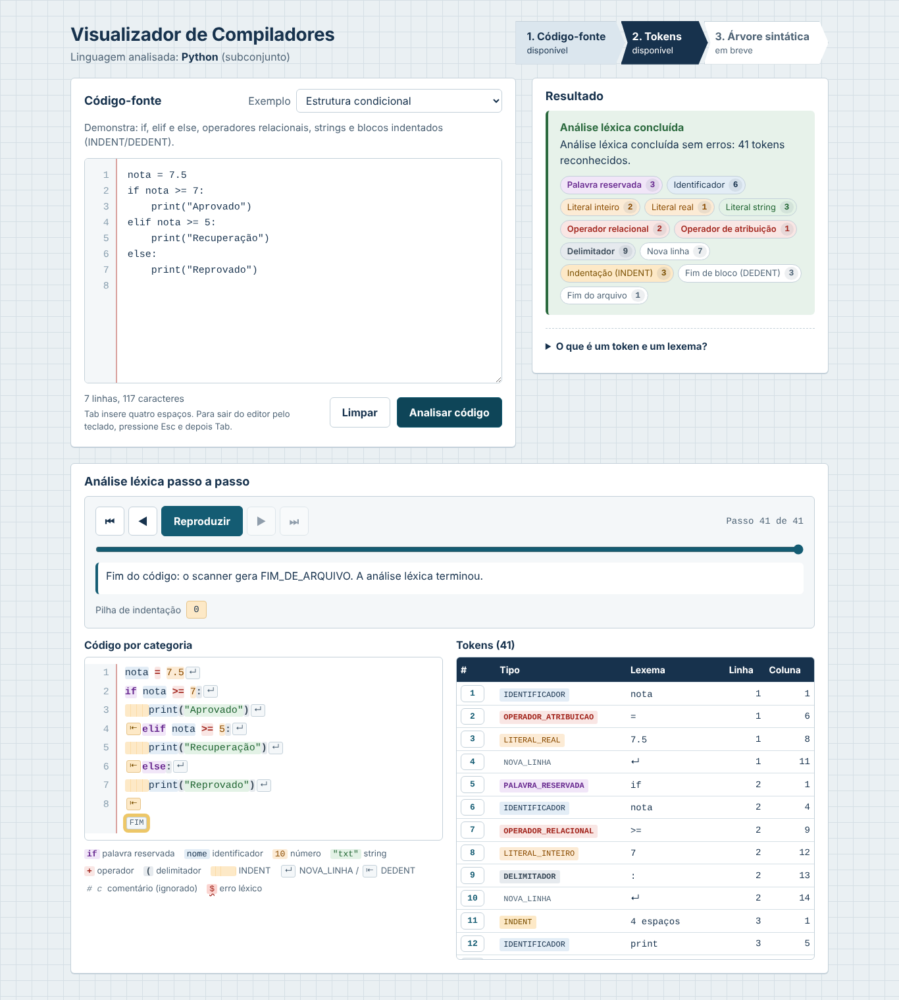
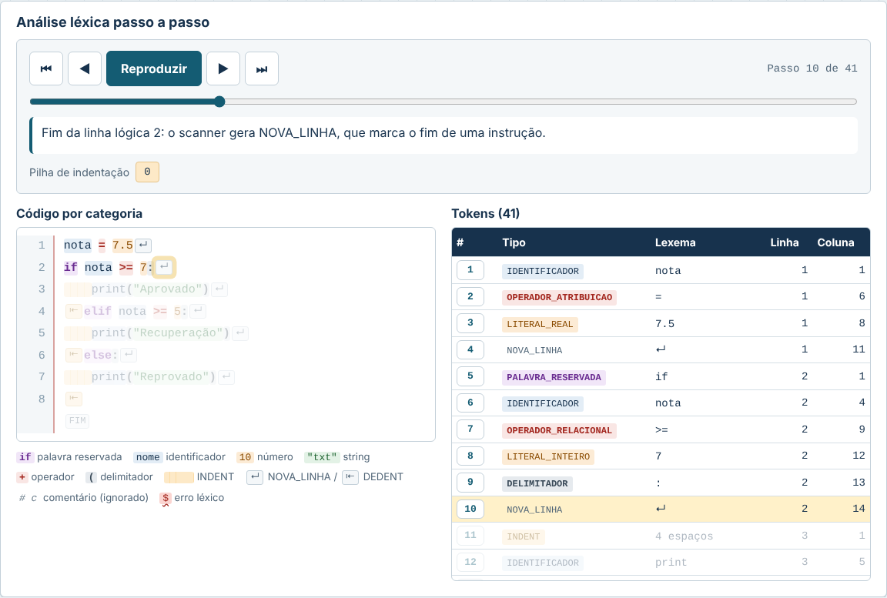

# Compiladores — Visualizador Educacional

Software educacional web para estudar as **análises léxica e sintática** com programas escritos em um subconjunto da linguagem **Python**. É voltado a estudantes de graduação em Computação que cursam a disciplina de Compiladores.

> **Etapa atual: 3 — análise léxica (scanner).** O estudante escreve ou escolhe um programa e o servidor o divide em **tokens**. A interface mostra o código colorido por categoria, a tabela de tokens, os erros léxicos com linha e coluna e um **passo a passo** com a pilha de indentação. A análise sintática (parser) ainda **não** foi implementada; ela é a Etapa 4.
>
> - Primeiro uso: [`docs/tutorial.md`](docs/tutorial.md)
> - Escopo léxico (categorias, decisões e erros): [`docs/escopo-lexico.md`](docs/escopo-lexico.md)
> - Definição do problema e revisão de literatura: [`docs/revisao-literatura.md`](docs/revisao-literatura.md)



## Sumário

1. [Objetivo](#1-objetivo)
2. [Linguagem escolhida e subconjunto](#2-linguagem-escolhida-e-subconjunto)
3. [Tecnologias](#3-tecnologias)
4. [Estrutura do repositório](#4-estrutura-do-repositório)
5. [Pré-requisitos](#5-pré-requisitos)
6. [Como executar e acessar](#6-como-executar-e-acessar)
7. [Como encerrar](#7-como-encerrar)
8. [Usando a interface](#8-usando-a-interface)
9. [Exemplos disponíveis](#9-exemplos-disponíveis)
10. [Comunicação entre frontend e backend](#10-comunicação-entre-frontend-e-backend)
11. [Testes](#11-testes)
12. [Limitações conhecidas](#12-limitações-conhecidas)
13. [Histórico das etapas](#13-histórico-das-etapas)
14. [Analisador léxico (Etapa 3)](#14-analisador-léxico-etapa-3)

---

## 1. Objetivo

Ajudar estudantes a compreender como um compilador lê um programa, mostrando passo a passo o reconhecimento de tokens por autômatos finitos e a construção da árvore sintática, a partir de um código que o próprio estudante escreve. A ferramenta usa Python porque muitos alunos já conhecem a linguagem, o que permite concentrar o esforço nos conceitos de compilação.

## 2. Linguagem escolhida e subconjunto

### Por que Python

| Motivo | Explicação |
| --- | --- |
| Familiaridade | É a linguagem com que muitos alunos começam a graduação; o estudante analisa um código que já sabe ler. |
| Sintaxe enxuta | Permite definir um subconjunto pequeno sem perder realismo. |
| Desafio léxico próprio | A indentação gera os tokens `INDENT` e `DEDENT`, conceito ausente em linguagens delimitadas por chaves e pouco explorado nas ferramentas existentes. |
| Validação | Os módulos nativos `tokenize` e `ast` poderão servir de referência para conferir os resultados dos analisadores. |

### Subconjunto

O projeto **não** cobre o Python inteiro. O scanner da Etapa 3 já reconhece todo o subconjunto abaixo; o parser da Etapa 4 vai tratar as mesmas construções. A tabela de escopo léxico completa está na [seção 14](#14-analisador-léxico-etapa-3) e em [`docs/escopo-lexico.md`](docs/escopo-lexico.md).

| Categoria | Construções incluídas | Exemplo |
| --- | --- | --- |
| Literais | Inteiros, números de ponto flutuante, strings entre aspas, `True`, `False` | `42`, `3.14`, `"oi"` |
| Identificadores e atribuição | Nomes de variáveis e atribuição simples | `x = 10` |
| Operadores aritméticos | `+`, `-`, `*`, `/`, `%` e parênteses | `(a + b) * 2` |
| Operadores relacionais | `==`, `!=`, `<`, `<=`, `>`, `>=` | `x >= 0` |
| Condicional | `if` / `elif` / `else` com blocos indentados | `if x > 0:` |
| Repetição | `while` com bloco indentado | `while i < 10:` |
| Saída | Chamada a `print(...)` | `print(x)` |
| Estrutura de bloco | Tokens `NOVA_LINHA`, `INDENT`, `DEDENT` e comentários `#` | — |

**Fora do escopo inicial:** funções (`def`), `for`, listas, dicionários, classes, `import` e operadores lógicos (`and`, `or`, `not`).

## 3. Tecnologias

| Parte | Tecnologia | Observação |
| --- | --- | --- |
| Frontend | HTML, CSS e JavaScript (módulos ES, sem etapa de build) | Servido pelo **Nginx 1.27** |
| Backend | **Python 3.12** com **Starlette 1.6** e **Uvicorn 0.53** | Na Etapa 2 a API passou de FastAPI para Starlette, a base do próprio FastAPI, por ser mais leve; o contrato da Etapa 1 foi mantido |
| Orquestração | **Docker Compose** | Serviços `frontend` e `backend`, mais o perfil `testes` |
| Testes do backend | `unittest` (biblioteca padrão do Python) | Sem dependências extras |
| Testes do frontend | `node --test` (Node.js 22) | Sem dependências extras |
| Testes de interface e ponta a ponta | **Playwright 1.56** (Python) com Chromium | Imagem `tests/e2e/Dockerfile`, baseada na oficial `mcr.microsoft.com/playwright/python:v1.56.0-noble` |

Não há banco de dados: o projeto ainda não precisa guardar informações.

## 4. Estrutura do repositório

```
compiladores/
├── backend/
│   ├── app/
│   │   ├── main.py            # rotas da API e tratamento de erros
│   │   ├── scanner.py         # analisador léxico (Etapa 3)
│   │   └── validacao.py       # regras de validação da entrada (sem dependência do framework)
│   ├── tests/
│   │   ├── cliente_asgi.py    # cliente HTTP em processo para os testes
│   │   ├── test_api.py        # testes dos endpoints
│   │   ├── test_scanner.py    # testes unitários do scanner e comparação com o tokenize
│   │   └── test_validacao.py  # testes unitários das regras
│   ├── Dockerfile
│   └── requirements.txt
├── frontend/
│   ├── index.html             # tela principal
│   ├── css/estilo.css
│   ├── js/
│   │   ├── app.js             # ponto de entrada
│   │   ├── interface.js       # liga a tela ao comportamento (tabela, cores, passo a passo)
│   │   ├── lexico.js          # prepara os tokens para exibição (sem acesso ao DOM)
│   │   ├── api.js             # comunicação com o backend
│   │   ├── validacao.js       # validação no navegador
│   │   └── exemplos.js        # programas de exemplo
│   ├── tests/unit/            # testes unitários (node --test)
│   ├── nginx.conf             # serve o frontend e repassa /api/ ao backend
│   ├── package.json
│   └── Dockerfile
├── tests/e2e/
│   ├── test_interface.py      # testes de interface e ponta a ponta (Playwright)
│   ├── servidor_local.py      # frontend + backend juntos para testar sem Docker
│   └── Dockerfile             # imagem dos testes de interface
├── scripts/
│   ├── testar.ps1             # roda todos os testes no Docker (Windows)
│   └── testar.sh              # idem (Linux/macOS)
├── docs/
│   ├── escopo-lexico.md       # categorias de token, decisões e erros léxicos
│   ├── tutorial.md            # roteiro de primeiro uso
│   ├── testes.md              # registro das execuções de teste
│   ├── interface/             # capturas de tela da interface
│   ├── validacao/             # evidências da validação da Etapa 1
│   └── revisao-literatura.md
├── docker-compose.yml
└── README.md
```

## 5. Pré-requisitos

| Ferramenta | Versão mínima | Como verificar |
| --- | --- | --- |
| Git | 2.30 | `git --version` |
| Docker Engine (ou Docker Desktop) | 24.0 | `docker --version` |
| Docker Compose (plugin v2) | 2.20 | `docker compose version` |

A porta **8080** precisa estar livre. Não é necessário instalar Python nem Node.js: tudo, inclusive os testes, roda em contêineres. Na primeira execução dos testes, o Docker baixa as imagens do Node e do Playwright (cerca de 2 GB no total).

> No Windows e no macOS, instale o [Docker Desktop](https://www.docker.com/products/docker-desktop/), que já inclui o Docker Compose. No Linux, instale o [Docker Engine](https://docs.docker.com/engine/install/) e o plugin `docker-compose-plugin`.

## 6. Como executar e acessar

```bash
git clone https://github.com/HenriqueNeuhaus/compiladores.git
cd compiladores
docker compose up --build -d --wait
```

O `--wait` faz o comando só terminar quando o backend e o frontend estiverem saudáveis. Depois, abra **http://localhost:8080** no navegador.

Para conferir pelo terminal:

```bash
docker compose ps                               # backend e frontend como "healthy"
curl http://localhost:8080/api/health            # {"status":"ok","versao":"0.3.0"}
```

No PowerShell do Windows, use `curl.exe` no lugar de `curl`.

## 7. Como encerrar

```bash
docker compose down              # para e remove os contêineres e a rede
docker compose down --rmi local  # também remove as imagens construídas pelo projeto
```

## 8. Usando a interface

Um roteiro guiado, com exercícios, está em [`docs/tutorial.md`](docs/tutorial.md).

| Elemento | O que faz |
| --- | --- |
| Cabeçalho | Mostra o nome do sistema, a linguagem analisada (Python, subconjunto) e as fases do compilador. **Código-fonte** e **Tokens** estão disponíveis; **Árvore sintática** aparece como "em breve". |
| **Exemplo** | Lista os programas prontos. Ao escolher um, o código **substitui** o conteúdo do editor e uma linha explica o que ele demonstra. O código carregado pode ser editado. |
| Editor de código | Fonte monoespaçada e numeração de linhas. **Tab** insere quatro espaços; para sair do editor pelo teclado, pressione **Esc** e depois **Tab**. Abaixo há um contador de linhas e caracteres. |
| **Analisar código** | Envia o código ao backend. Durante o envio o botão fica desabilitado e mostra "Analisando…". |
| **Limpar** | Esvazia o editor, o resultado e a análise. |
| **Resultado** | Antes da primeira análise, mostra o tutorial "Como usar". Depois, mostra a mensagem do scanner, a **contagem de tokens por categoria**, a lista de **erros léxicos** e de **avisos**, cada um com o botão **Mostrar no código**, que seleciona o trecho no editor. |
| **O que é um token e um lexema?** | Explicação curta dos conceitos, que pode ser aberta e fechada. |
| **Análise léxica passo a passo** | Aparece depois da análise. Tem o **código colorido por categoria** (com `↵` para `NOVA_LINHA` e `⇤` para `DEDENT`), a **tabela de tokens** (#, tipo, lexema, linha, coluna) e o **reprodutor**: primeiro, anterior, reproduzir/pausar, próximo e último passo, barra deslizante, setas do teclado, explicação de cada decisão do scanner e a pilha de indentação. Os tokens ainda não lidos ficam esmaecidos. Clicar (ou tocar) em um token do código ou no número dele na tabela leva ao passo correspondente. Se o código for editado depois da análise, um aviso pede para analisar de novo. |

A página funciona em telas de celular (a partir de 360 px) sem rolagem horizontal; a tabela e o código têm rolagem própria e os botões do reprodutor têm pelo menos 40 px de altura para toque.



### Mensagens apresentadas

| Situação | Onde é detectada | Mensagem |
| --- | --- | --- |
| Editor vazio | Navegador (e backend) | Informe um código-fonte antes de solicitar a análise. |
| Só espaços ou quebras de linha | Navegador (e backend) | O código informado contém apenas espaços ou quebras de linha. Escreva um programa ou escolha um exemplo. |
| Mais de 20 000 caracteres | Navegador (e backend) | O código informado ultrapassa o limite de 20000 caracteres. |
| Requisição fora do contrato | Backend | Mensagem específica do problema (JSON inválido, campo ausente etc.) |
| Servidor fora do ar, rede indisponível ou mais de 10 s sem resposta | Navegador | Não foi possível comunicar com o servidor. Verifique a conexão e tente novamente. |
| Erro inesperado no servidor | Backend e navegador | Ocorreu um erro inesperado ao processar a solicitação. Tente novamente. |
| Código sem erros léxicos | Scanner | Análise léxica concluída sem erros: N tokens reconhecidos. |
| Código com erros léxicos | Scanner | Análise léxica concluída com N erro(s) léxico(s) encontrado(s). Os trechos válidos foram reconhecidos como M tokens. Em seguida, uma mensagem por erro, por exemplo: *Erro léxico na linha 3, coluna 19: caractere não reconhecido '$'. Verifique se ele faz parte do subconjunto suportado.* |

O resultado sem erros aparece em verde; erros léxicos, falhas de comunicação e erros inesperados, em vermelho; problemas na entrada, em amarelo. Nenhuma mensagem expõe rastreamentos, caminhos internos ou variáveis do servidor.

## 9. Exemplos disponíveis

| Exemplo | O que demonstra | Resultado léxico |
| --- | --- | --- |
| Atribuição e expressões aritméticas | Atribuição, números inteiros e reais, operadores `+ - * /`, parênteses, comentário e `print` | Sem erros |
| Estrutura condicional | `if`, `elif` e `else`, operadores relacionais, strings e blocos indentados (`INDENT`/`DEDENT`) | Sem erros, 41 tokens |
| Repetição com blocos aninhados | `while`, `if` dentro de `while`, operador `%`, comparação `==` e vários níveis de indentação | Sem erros, 51 tokens |
| Erro sintático (tokens válidos) | `if` sem os dois-pontos: todos os tokens são válidos, então o erro só será detectado pela análise sintática (Etapa 4) | Sem erros léxicos |
| Erros léxicos | Identificador com acento, caractere `$`, string sem fechar e operador `//`; o scanner continua depois de cada erro | 5 erros, 27 tokens |

O código de cada exemplo está em [`frontend/js/exemplos.js`](frontend/js/exemplos.js).

## 10. Comunicação entre frontend e backend

O navegador sempre chama a API no mesmo endereço da página (`/api/...`). O Nginx do contêiner `frontend` repassa essas requisições para `http://backend:8000`, nome que só existe dentro da rede do Docker. Assim, o navegador nunca precisa conhecer o endereço interno do backend.

```
Navegador ──► frontend (Nginx, porta 8080) ──/api/──► backend (Starlette, porta 8000)
```

### `POST /api/analisar`

Requisição (`Content-Type: application/json`):

```json
{ "codigo": "x = 10\nprint(x)" }
```

Resposta **200** (a análise rodou). Exemplo para `if x >= 1:\n    print("oi")  # saudação\n`, com listas encurtadas:

```json
{
  "recebido": true,
  "mensagem": "Análise léxica concluída sem erros: 14 tokens reconhecidos.",
  "estatisticas": { "linhas": 2, "caracteres": 39 },
  "sucesso": true,
  "tokens": [
    { "tipo": "PALAVRA_RESERVADA", "lexema": "if", "linha": 1, "coluna": 1,
      "linha_final": 1, "coluna_final": 2, "fora_do_subconjunto": false },
    { "tipo": "IDENTIFICADOR", "lexema": "x", "linha": 1, "coluna": 4,
      "linha_final": 1, "coluna_final": 4, "fora_do_subconjunto": false },
    { "tipo": "OPERADOR_RELACIONAL", "lexema": ">=", "linha": 1, "coluna": 6,
      "linha_final": 1, "coluna_final": 7, "fora_do_subconjunto": false },
    "...",
    { "tipo": "INDENT", "lexema": "    ", "linha": 2, "coluna": 1,
      "linha_final": 2, "coluna_final": 4, "fora_do_subconjunto": false },
    "...",
    { "tipo": "DEDENT", "lexema": "", "linha": 3, "coluna": 1,
      "linha_final": 3, "coluna_final": 0, "fora_do_subconjunto": false },
    { "tipo": "FIM_DE_ARQUIVO", "lexema": "", "linha": 3, "coluna": 1,
      "linha_final": 3, "coluna_final": 0, "fora_do_subconjunto": false }
  ],
  "erros": [],
  "avisos": [],
  "comentarios": [ { "lexema": "# saudação", "linha": 2, "coluna": 18, "coluna_final": 27 } ],
  "contagem": { "PALAVRA_RESERVADA": 1, "IDENTIFICADOR": 2, "LITERAL_INTEIRO": 1, "LITERAL_REAL": 0,
                "LITERAL_STRING": 1, "OPERADOR_ARITMETICO": 0, "OPERADOR_RELACIONAL": 1,
                "OPERADOR_ATRIBUICAO": 0, "DELIMITADOR": 3, "NOVA_LINHA": 2, "INDENT": 1,
                "DEDENT": 1, "FIM_DE_ARQUIVO": 1 },
  "passos": [
    { "indice": 0, "tipo": "token", "token": 0, "linha": 1, "coluna": 1, "linha_final": 1,
      "coluna_final": 2, "pilha": [0],
      "descricao": "Leu 'if': tem a forma de um identificador, mas está na lista de palavras reservadas → PALAVRA_RESERVADA." },
    "..."
  ]
}
```

| Campo | Significado |
| --- | --- |
| `recebido`, `estatisticas` | Mantidos da Etapa 2 (compatibilidade). |
| `mensagem` | Resumo da análise léxica, pronto para exibir. |
| `sucesso` | `true` se não houve erro léxico (avisos não contam). |
| `tokens` | Tokens em ordem. Linhas e colunas começam em 1; `coluna_final` é a coluna do último caractere (tokens sem texto têm `coluna_final = coluna - 1`). `fora_do_subconjunto` marca palavras reservadas de Python que o subconjunto não aceita. |
| `erros` | Erros léxicos: `tipo` (`ERRO_LEXICO`), `codigo` (ver [`docs/escopo-lexico.md`](docs/escopo-lexico.md#3-erros-e-avisos-léxicos)), `lexema`, posição inicial e final e `mensagem`. |
| `avisos` | Mesmo formato, com `tipo` igual a `AVISO`. |
| `comentarios` | Comentários lidos e descartados. |
| `contagem` | Quantidade de tokens por categoria (as 13 categorias sempre aparecem). |
| `passos` | Uma entrada por decisão do scanner, em ordem: `tipo` (`token`, `erro` ou `ignorado`), `descricao`, posição, pilha de indentação naquele momento e o índice do `token` ou do `erro` correspondente. |

Com erro léxico a resposta continua **200**, com `sucesso: false`, porque o problema está no programa analisado e não na requisição. Exemplo para `x = 1 $ 2`:

```json
{
  "sucesso": false,
  "mensagem": "Análise léxica concluída com 1 erro léxico encontrado. Os trechos válidos foram reconhecidos como 6 tokens.",
  "erros": [
    { "tipo": "ERRO_LEXICO", "codigo": "caractere_nao_reconhecido", "lexema": "$",
      "linha": 1, "coluna": 7, "linha_final": 1, "coluna_final": 7,
      "mensagem": "Erro léxico na linha 1, coluna 7: caractere não reconhecido '$'. Verifique se ele faz parte do subconjunto suportado." }
  ],
  "...": "demais campos como no exemplo anterior"
}
```

Respostas de erro, sempre no mesmo formato:

```json
{ "recebido": false, "erro": { "tipo": "entrada_vazia", "mensagem": "Informe um código-fonte antes de solicitar a análise." } }
```

| Código HTTP | `erro.tipo` | Quando ocorre |
| --- | --- | --- |
| 400 | `json_invalido` | Corpo vazio, que não é JSON ou que não está em UTF-8 |
| 400 | `entrada_vazia` | `codigo` é um texto vazio |
| 400 | `entrada_em_branco` | `codigo` tem só espaços, tabulações ou quebras de linha |
| 413 | `entrada_muito_grande` | `codigo` com mais de 20 000 caracteres |
| 422 | `corpo_nao_objeto` | O JSON não é um objeto (por exemplo, uma lista) |
| 422 | `campo_ausente` | Falta o campo `codigo` |
| 422 | `tipo_invalido` | `codigo` não é texto (número, nulo, lista…) |
| 404 | `rota_inexistente` | Endereço da API que não existe |
| 405 | `metodo_nao_permitido` | Método errado, por exemplo `GET /api/analisar` |
| 500 | `erro_interno` | Erro inesperado; o detalhe fica só no log do servidor |

### Outros endpoints

| Endpoint | Resposta | Uso |
| --- | --- | --- |
| `GET /api/health` | `{"status": "ok", "versao": "0.3.0"}` | Healthcheck do Docker Compose |
| `GET /api/hello` | `{"message": "Hello, World!"}` | Mantido da Etapa 1, por compatibilidade |

## 11. Testes

Os testes cresceram junto com cada funcionalidade e cobrem cinco níveis:

| Tipo | O que verifica | Ferramenta | Arquivos | Quantidade |
| --- | --- | --- | --- | --- |
| Unitário do scanner | Palavras reservadas, identificadores, literais, operadores simples e compostos, delimitadores, comentários, espaços, indentação, posições, cada erro léxico, casos de borda e comparação com o `tokenize` do Python em 300 programas aleatórios | `unittest` | `backend/tests/test_scanner.py` | 58 |
| Unitário (backend) | Regras de validação e estatísticas | `unittest` | `backend/tests/test_validacao.py` | 20 |
| Endpoints (backend) | Contrato JSON com tokens e erros, erro léxico com 200 e `sucesso: false`, códigos HTTP, entrada vazia sem executar o scanner, falha do scanner como 500 genérico, regressão das Etapas 1 e 2 | `unittest` | `backend/tests/test_api.py` | 29 |
| Unitário (frontend) | Validação, exemplos, cliente da API e preparação dos tokens para exibição (cores, lexemas visíveis, contagem, segmentação do código) | `node --test` | `frontend/tests/unit/*.test.js` | 53 |
| Interface e ponta a ponta | Tela, edição, exemplos, envio, mensagens, tabela de tokens, código colorido, erros léxicos, "Mostrar no código", passo a passo (botões, teclado, reprodução, pilha), aviso de código alterado, celular com toque e regressão das etapas anteriores | Playwright | `tests/e2e/test_interface.py` | 47 |
| Implantação | Build das imagens e healthcheck dos dois serviços | Docker Compose (`--wait`) | `docker-compose.yml` | — |

### Rodar tudo no Docker (recomendado)

```powershell
# Windows (PowerShell)
powershell -ExecutionPolicy Bypass -File scripts\testar.ps1
```

```bash
# Linux ou macOS
bash scripts/testar.sh
```

Os scripts sobem a aplicação com `--wait` (teste de implantação), rodam as três suítes e mostram um resumo. Também é possível rodar cada suíte separadamente:

```bash
docker compose up -d --build --wait
docker compose --profile testes run --build --rm testes-backend    # backend
docker compose --profile testes run --build --rm testes-frontend   # frontend (unitários)
docker compose --profile testes run --build --rm testes-e2e        # interface (Playwright contra o Nginx)
```

### Rodar sem Docker

Requer Python 3.12+, Starlette, Uvicorn, Playwright para Python com Chromium e Node.js 22.

```bash
cd backend && python -m unittest discover -s tests -t . -v && cd ..
cd frontend && node --test "tests/unit/*.test.js" && cd ..
python tests/e2e/servidor_local.py --porta 8090 &
BASE_URL=http://localhost:8090 python -m unittest tests.e2e.test_interface -v
```

### Resultados

| Data | Ambiente | Backend | Frontend | Interface | Implantação no Docker |
| --- | --- | --- | --- | --- | --- |
| 15/10/2026 | Linux, Python 3.13, Node 22, servidor local | 41 de 41 | 39 de 39 | 31 de 31 | não executada nesse ambiente |
| 15/10/2026 | Windows, Docker 29.8.2 (`scripts/testar.ps1`), 1ª execução | aprovado | aprovado | falhou: pacote `playwright` ausente na imagem (corrigido) | aprovada |
| 15/10/2026 | Windows, Docker 29.8.2 (`scripts/testar.ps1`), após a correção | aprovado | aprovado | 31 de 31 | aprovada (build + healthcheck) |
| 27/10/2026 | Etapa 3 — Linux, Python 3.13, Node 22, servidor local | 107 de 107 | 53 de 53 | 47 de 47 | não executada nesse ambiente |
| 27/10/2026 | Etapa 3 — Windows, Docker 29.8.2 (`scripts/testar.ps1`) | aprovado | aprovado | 47 de 47 | aprovada (build + healthcheck) |

Evidências da execução no Docker — Etapa 2: [testes](docs/validacao/04-etapa2-testes-docker.png) e [interface](docs/validacao/05-etapa2-interface-docker.png); Etapa 3: [testes](docs/validacao/06-etapa3-testes-docker.png) e [interface](docs/validacao/07-etapa3-interface-docker.png).

O registro completo, com os comandos, as falhas encontradas e as correções, está em [`docs/testes.md`](docs/testes.md).

## 12. Limitações conhecidas

- A análise **sintática** ainda não existe: o scanner aceita qualquer sequência de tokens válidos (por exemplo, `if x > 5` sem `:` ou `) x (`). Isso é intencional e será tratado na Etapa 4.
- O subconjunto é pequeno de propósito: números em outras bases, notação científica, strings com três aspas ou prefixo, f-strings e operadores como `**`, `//` e `+=` geram erro léxico. Palavras reservadas como `for` e `def` geram apenas aviso.
- Identificadores aceitam só letras ASCII (Python aceita acentos).
- O passo a passo mostra as decisões do scanner token a token; ainda não desenha o autômato finito de cada categoria.
- O editor é um campo de texto simples: o realce colorido aparece no painel da análise, não durante a digitação.
- A análise é refeita só quando o estudante clica em **Analisar código**; ao editar, um aviso indica que o resultado está desatualizado.
- O scanner registra no máximo 100 erros por análise.
- As fontes Atkinson Hyperlegible e JetBrains Mono vêm do Google Fonts; sem internet, a página usa fontes do sistema.
- Os testes de interface usam apenas o Chromium.

## 13. Histórico das etapas

| Etapa | Entrega | Situação |
| --- | --- | --- |
| 1 | Linguagem, estrutura inicial, Docker e "Hello, World!" | Concluída; validação limpa no Windows em 15/10/2026, com evidências em [`docs/validacao/`](docs/validacao/) |
| 2 | Interface web, entrada de código, exemplos, comunicação, validações e testes automatizados | Concluída; validada no Docker (Windows) em 15/10/2026 |
| 3 | Analisador léxico do subconjunto, tabela de tokens, código colorido, erros léxicos e passo a passo com `INDENT`/`DEDENT` | Esta versão (0.3.0); validada no Docker (Windows) em 27/10/2026 |
| 4 | Analisador sintático com construção passo a passo da árvore | Prevista |

## 14. Analisador léxico (Etapa 3)

### Escopo léxico

| Categoria | Lexemas aceitos | Exemplo |
| --- | --- | --- |
| `PALAVRA_RESERVADA` | `if`, `elif`, `else`, `while`, `True`, `False` | `while` |
| `IDENTIFICADOR` | letra ASCII ou `_`, depois letras, dígitos ou `_` (`print` é identificador) | `soma_total` |
| `LITERAL_INTEIRO` | dígitos decimais, sem zeros à esquerda | `42` |
| `LITERAL_REAL` | dígitos, ponto, dígitos | `3.14` |
| `LITERAL_STRING` | aspas simples ou duplas na mesma linha, com escapes | `"Aprovado"` |
| `OPERADOR_ARITMETICO` | `+ - * / %` | `%` |
| `OPERADOR_RELACIONAL` | `== != < <= > >=` | `>=` |
| `OPERADOR_ATRIBUICAO` | `=` | `=` |
| `DELIMITADOR` | `( ) : ,` | `:` |
| `NOVA_LINHA` | fim de uma linha lógica com tokens | `↵` |
| `INDENT` / `DEDENT` | início e fim de bloco pela indentação | 4 espaços |
| `FIM_DE_ARQUIVO` | fim do código | — |
| Ignorados | espaços, linhas em branco e comentários `#` | `# nota` |

As regras completas, as decisões de projeto e os 14 códigos de erro e aviso estão em [`docs/escopo-lexico.md`](docs/escopo-lexico.md).

### Como o scanner funciona

O scanner ([`backend/app/scanner.py`](backend/app/scanner.py)) foi **escrito à mão**, sem geradores como Lex/Flex nem expressões regulares para o código inteiro. Ele percorre o texto caractere a caractere, guardando linha e coluna, e decide pelo primeiro caractere qual rotina chamar:

| Primeiro caractere | Rotina | Comportamento |
| --- | --- | --- |
| início de linha | `_processar_inicio_de_linha` | mede o recuo, compara com a pilha de indentação e gera `INDENT`/`DEDENT`; ignora linhas em branco ou só com comentário |
| letra ou `_` | `_ler_palavra` | lê o maior identificador possível e consulta a tabela de palavras reservadas |
| dígito | `_ler_numero` | lê inteiro ou real e explica formatos fora do subconjunto |
| `"` ou `'` | `_ler_string_como_token` | lê até a aspa de fechamento na mesma linha |
| `#` | `_ler_comentario` | descarta até o fim da linha |
| demais | `_ler_operador_ou_desconhecido` | tenta operadores de 3, 2 e 1 caractere (casamento mais longo); se nada casar, registra caractere não reconhecido |

Cada decisão vira um **passo** com uma explicação em português e o estado da pilha de indentação. A interface usa esses passos para o reprodutor.

**Por que escrever à mão?** Cada rotina corresponde a um autômato finito simples, o que deixa o código fácil de ler para quem estuda a disciplina e permite gerar mensagens específicas (por exemplo, explicar que `//` existe em Python mas não no subconjunto). A indentação de Python também exige uma pilha, o que não cabe em uma expressão regular. Por fim, o `tokenize` da biblioteca padrão serve de **oráculo** nos testes: o scanner é comparado a ele token a token em programas fixos e em 300 programas aleatórios.

**Recuperação de erros:** ao encontrar um erro, o scanner registra a mensagem, pula o trecho inválido (o caractere, o restante da palavra, o número ou a string) e continua. Assim o estudante vê todos os erros de uma vez e os trechos válidos continuam na tabela.

### Comandos de teste da Etapa 3

```bash
# só o scanner
cd backend && python -m unittest tests.test_scanner -v
# backend completo, frontend e interface
cd backend && python -m unittest discover -s tests -t . -v && cd ..
cd frontend && node --test "tests/unit/*.test.js" && cd ..
BASE_URL=http://localhost:8090 python -m unittest tests.e2e.test_interface -v
# tudo no Docker
powershell -ExecutionPolicy Bypass -File scripts\testar.ps1   # Windows
bash scripts/testar.sh                                          # Linux/macOS
```

O registro das execuções, incluindo as falhas encontradas e a verificação por mutação, está em [`docs/testes.md`](docs/testes.md#etapa-3--análise-léxica-scanner-27102026).

### Relação com a Etapa 4

O parser da Etapa 4 vai consumir a lista `tokens` exatamente como ela sai do endpoint: os tokens `NOVA_LINHA`, `INDENT` e `DEDENT` já marcam o fim das instruções e os blocos, o que permite escrever a gramática sem lidar com espaços. Se houver erro léxico, a análise sintática não será executada, e a interface continuará mostrando os erros léxicos. Os campos `linha` e `coluna` de cada token servirão para localizar os erros sintáticos, e o passo a passo será estendido para mostrar a construção da árvore.
