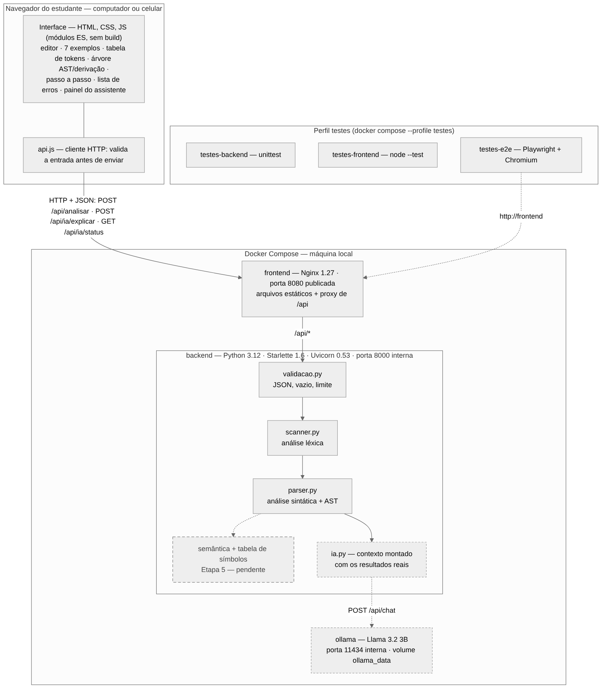
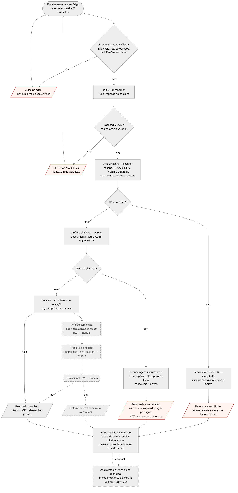

# 3 Materiais e Métodos

> Texto da seção **Materiais e Métodos** do artigo, versão da Tarefa 4 (proposta, fluxograma e plano de avaliação). Descreve o software na versão 0.4.0 e o método planejado para avaliá-lo. Partes ainda não implementadas estão marcadas como **pendente (Etapa 5)** ou **planejado**. Voltar ao [README](../README.md).
>
> Documentos relacionados: [casos de teste](casos-de-teste.md) · [plano de avaliação e formulário](plano-de-avaliacao.md) · [gramática](gramatica.md) · [registro de testes](testes.md) · [revisão de literatura](revisao-literatura.md).

Este trabalho é uma pesquisa aplicada de desenvolvimento de software educacional, conduzida de forma incremental em cinco etapas (linguagem e ambiente; interface; análise léxica; análise sintática; análise semântica). Cada etapa produziu uma versão executável, testada antes da seguinte. A avaliação combina verificação técnica automatizada, testes manuais roteirizados, avaliação das explicações geradas por IA e uma avaliação por pares com estudantes e professor, descritas na seção 3.6.

## 3.1 Linguagem e escopo

**Linguagem analisada.** Um subconjunto de Python 3. A escolha se apoia em três razões, já apresentadas na Introdução: é a linguagem com que muitos estudantes iniciam a graduação, permite um subconjunto pequeno sem perder realismo e tem uma particularidade léxica pouco explorada no ensino, a indentação significativa, que o scanner transforma nos tokens `NOVA_LINHA`, `INDENT` e `DEDENT`. Nenhuma das dez ferramentas e estudos analisados nas Etapas 1 a 4 usa Python como linguagem de entrada (ver [revisão de literatura](revisao-literatura.md)).

**Subconjunto suportado.** Atribuição simples; literais inteiros, reais, strings (aspas simples ou duplas) e lógicos (`True`, `False`); operadores aritméticos `+ - * / %`, menos e mais unários e os seis relacionais; parênteses; chamadas de função com zero ou mais argumentos (`print(...)`); `if`/`elif`/`else`; `while`; blocos aninhados por indentação; comentários de linha.

**Gramática.** Quinze regras em EBNF, com símbolo inicial `programa`, sem recursão à esquerda. Decisões com um token à frente, exceto a distinção entre atribuição e chamada no início da instrução, que usa dois (LL(2) local). A versão comentada, com a tabela de precedência e a correspondência com os tokens, está em [`gramatica.md`](gramatica.md); um teste automatizado falha se o código e o documento divergirem.

```ebnf
programa        = { instrucao } FIM_DE_ARQUIVO ;
instrucao       = atribuicao | chamada_simples | condicional | repeticao ;
atribuicao      = IDENTIFICADOR "=" expressao NOVA_LINHA ;
chamada_simples = chamada NOVA_LINHA ;
condicional     = "if" expressao ":" bloco { "elif" expressao ":" bloco } [ "else" ":" bloco ] ;
repeticao       = "while" expressao ":" bloco ;
bloco           = NOVA_LINHA INDENT instrucao { instrucao } DEDENT ;
expressao       = comparacao ;
comparacao      = soma [ OPERADOR_RELACIONAL soma ] ;
soma            = termo { ( "+" | "-" ) termo } ;
termo           = fator { ( "*" | "/" | "%" ) fator } ;
fator           = ( "+" | "-" ) fator | primario ;
primario        = LITERAL_INTEIRO | LITERAL_REAL | LITERAL_STRING | "True" | "False"
                | chamada | IDENTIFICADOR | "(" expressao ")" ;
chamada         = IDENTIFICADOR "(" [ argumentos ] ")" ;
argumentos      = expressao { "," expressao } ;
```

**Não suportado (decisão de escopo).** `def`, `return`, `for`, `and`/`or`/`not`, `in`, listas, dicionários, índices, atributos (`a.b`), atribuições múltiplas e compostas (`+=`), comparações encadeadas (`a < b < c`), `**` e `//`, strings com três aspas ou prefixo, números em outras bases ou em notação científica e identificadores com acentos. Palavras reservadas de Python fora do subconjunto geram aviso léxico e erro sintático específico; operadores fora do subconjunto geram erro léxico. O escopo léxico completo está em [`escopo-lexico.md`](escopo-lexico.md).

**Público-alvo.** Estudantes de graduação em Ciência da Computação, Inteligência Artificial e cursos afins que cursam ou revisam Compiladores, e professores que queiram demonstrar as fases de análise em aula.

**Funcionalidades educacionais.**

| Funcionalidade | Situação |
| --- | --- |
| Editor com sete exemplos comentados e validação da entrada | Implementado (Etapa 2) |
| Tabela de tokens, código colorido por categoria, erros e avisos léxicos com linha e coluna | Implementado (Etapa 3) |
| Passo a passo léxico, com a pilha de indentação e a geração de `INDENT`/`DEDENT` | Implementado (Etapa 3) |
| AST e árvore de derivação do mesmo programa, alternáveis, com expandir/recolher, filtro e exportação JSON | Implementado (Etapa 4) |
| Seleção de nó ou token com destaque do trecho no código, regra e produção da gramática | Implementado (Etapa 4) |
| Passo a passo do parser (entrar em regra, consumir token, construir nó, erro, recuperação), com reprodução automática | Implementado (Etapa 4) |
| Erros sintáticos com `encontrado`, `esperado`, regra violada e produção; recuperação com vários erros | Implementado (Etapa 4) |
| Assistente de IA (Ollama + Llama 3.2) que explica um nó, token ou erro a partir dos resultados do compilador, com aviso de que pode errar | Implementado, opcional (Etapa 4) |
| Uso por teclado, toque e telas a partir de 360 px | Implementado e testado (Etapas 2 a 4) |
| Análise semântica e tabela de símbolos (declaração antes do uso, compatibilidade de tipos, funções conhecidas) | **Pendente (Etapa 5)** |
| Geração de código | Fora do escopo |

## 3.2 Materiais e tecnologias

| Componente | Tecnologia e versão | Justificativa |
| --- | --- | --- |
| Implementação do compilador | Python 3.12 | Mesma linguagem analisada: os módulos `tokenize` e `ast` da biblioteca padrão servem de oráculo para validar o scanner e o parser |
| Scanner e parser | Código próprio, sem geradores | A estrutura do código espelha a gramática e os passos podem ser registrados para a interface (seção 3.3) |
| API HTTP | Starlette 1.6 e Uvicorn 0.53 | Framework ASGI mínimo; poucas dependências e testes sem servidor real |
| Interface | HTML, CSS e JavaScript (módulos ES), sem etapa de build | Roda em qualquer navegador moderno; o estudante pode ler o código-fonte da interface |
| Servidor web | Nginx 1.27 | Serve os arquivos estáticos e repassa `/api` ao backend (mesma origem, sem CORS) |
| Assistente (opcional) | Ollama (`ollama/ollama:latest`) com Llama 3.2 3B | Modelo aberto executado localmente: sem custo, sem chave de API e sem enviar o código dos estudantes a terceiros |
| Infraestrutura | Docker Compose (plugin v2) | Ambiente idêntico para estudante, professor e avaliadores |
| Testes | `unittest` (Python), `node --test` (Node.js 22), Playwright 1.56 com Chromium | Unitários, endpoints, interface e ponta a ponta |
| Diagramas | Mermaid (fontes `.mmd` em [`figuras/`](figuras/)) | Figuras versionadas como texto |

**Ambiente de execução.**

| Item | Valor |
| --- | --- |
| Sistemas operacionais | Windows 10/11, macOS ou Linux com Docker. Validado no Windows com Docker Desktop (Docker 29.8.2) e no Linux |
| Versões mínimas | Git 2.30; Docker Engine 24.0; Docker Compose 2.20 |
| Navegadores | Testes automatizados no Chromium (Playwright). Uso manual previsto em Chrome, Edge e Firefox atuais e em navegadores de celular; os não testados automaticamente serão conferidos nos testes manuais (seção 3.6) |
| Portas | 8080 publicada (interface e API, via Nginx); 8000 (backend) e 11434 (Ollama) apenas na rede interna do Compose |
| Dependências | Imagens `python:3.12-slim`, `nginx:1.27-alpine`, `ollama/ollama`, `node:22-alpine` e a imagem do Playwright; modelo `llama3.2` (cerca de 2 GB) no volume `ollama_data`. Não é preciso instalar Python nem Node.js |
| Iniciar | `docker compose up --build -d --wait` e abrir `http://localhost:8080`; opcionalmente, `docker compose exec ollama ollama pull llama3.2` (uma vez) |
| Encerrar | `docker compose down` (o volume do modelo é mantido); `docker compose down --rmi local` remove também as imagens construídas |
| Testes | `scripts\testar.ps1` (Windows) ou `scripts/testar.sh`; assistente: `scripts\testar-ia.ps1` |

**Programas de exemplo.** Os sete exemplos da interface ([`frontend/js/exemplos.js`](../frontend/js/exemplos.js)) foram escritos pelo autor para este projeto (origem autoral) e cobrem as construções do subconjunto e os três desfechos possíveis da análise. Os mesmos programas são verificados em testes automatizados.

| Exemplo | Objetivo didático | Construções | Resultado esperado | Critérios (3.6) |
| --- | --- | --- | --- | --- |
| Atribuição e expressões aritméticas | Primeiro contato: tokens e AST de expressões | atribuição, inteiro, real, `+ * /`, parênteses, `print`, comentário | Sem erros; AST com 4 atribuições e 2 chamadas | C1, C2, C7 |
| Estrutura condicional | Blocos por indentação | `if/elif/else`, relacionais, strings | Sem erros; `INDENT`/`DEDENT` em cada ramo; nó `CONDICIONAL` | C1, C2 |
| Repetição com blocos aninhados | Aninhamento e pilha de indentação | `while`, `if` dentro de `while`, `%`, `==` | Sem erros; dois níveis de bloco | C1, C2 |
| Precedência e associatividade | Comparar três árvores | `+` com `*`, subtração encadeada, parênteses, menos unário | Sem erros; a árvore mostra a ordem de avaliação | C2, C11, C12 |
| Erro sintático (tokens válidos) | Diferença entre erro léxico e sintático | `if` sem `:` | Nenhum erro léxico; 1 erro sintático (`dois_pontos_ausente`, linha 2) | C3 |
| Erros sintáticos (vários) | Recuperação de erros | operando ausente, `:` ausente, `elif` sem condição, atribuição a literal | 4 erros sintáticos (linhas 2, 3, 5 e 7), sem cascata | C3, C4 |
| Erros léxicos | Erros do scanner e decisão de não executar o parser | acento em nome, `$`, string sem fechar, `//` | 5 erros léxicos; parser não executado, com o motivo | C3 |

O conjunto completo de **45 casos de teste** (CT-01 a CT-45), com entrada, resultado esperado e análise envolvida, está na seção 3.5 e em [`casos-de-teste.md`](casos-de-teste.md).

**Materiais de apoio.** [README](../README.md) com instalação e uso; [tutorial](tutorial.md) para o estudante; [gramática comentada](gramatica.md) e [escopo léxico](escopo-lexico.md); legenda de categorias e de tipos de nó e botão de explicação na interface; assistente de IA opcional; [registro de testes](testes.md) com as execuções e falhas corrigidas.

## 3.3 Arquitetura



*Figura 1 — Componentes do sistema. Tracejado: pendente (análise semântica) ou opcional (assistente de IA). Fonte: [`figuras/arquitetura.mmd`](figuras/arquitetura.mmd).*

O sistema é uma aplicação web em três serviços do Docker Compose (Figura 1). O navegador recebe a interface do Nginx, que também repassa as chamadas `/api` ao backend. No backend, a requisição passa por validação, scanner e parser, nessa ordem; o resultado de cada fase é devolvido completo, para que a interface possa mostrar cada fase separadamente. O módulo de IA não participa da análise: só é chamado quando o estudante pede uma explicação, e então reanalisa o código e envia ao Ollama apenas os resultados do compilador.

**Contrato de comunicação.** `POST /api/analisar` recebe `{"codigo": "<texto>"}` e devolve um JSON com:

- os campos da Etapa 3, mantidos por compatibilidade: `recebido`, `mensagem`, `estatisticas`, `sucesso`, `tokens`, `erros`, `avisos`, `comentarios`, `contagem`, `passos`;
- `lexico`: `sucesso`, `mensagem`, `tokens`, `erros`, `avisos`;
- `sintatico`: `executado`, `sucesso`, `ast`, `derivacao`, `erros`, `contagem_nos`, `passos`, `passos_truncados`, `gramatica` e, quando o parser não é executado, `motivo`.

Cada nó da AST tem `id`, `tipo`, `regra`, `papel`, posição inicial e final, `atributos`, `passo` e `filhos`. Cada erro sintático tem `codigo`, posição, `encontrado`, `esperado`, `regra`, `producao` e `mensagem`, por exemplo:

```json
{"tipo": "ERRO_SINTATICO", "codigo": "operando_ausente", "linha": 1, "coluna": 8,
 "encontrado": "NOVA_LINHA", "esperado": ["expressao"], "regra": "soma",
 "producao": "soma = termo { ( \"+\" | \"-\" ) termo } ;",
 "mensagem": "Erro sintático na linha 1, coluna 8: o operador '+' precisa de um valor à direita, mas foi encontrado o fim da linha."}
```

Entradas inválidas recebem 400 (vazia ou só espaços), 413 (acima de 20 000 caracteres) ou 422 (JSON sem o campo `codigo` ou com tipo errado), sempre com `erro.tipo` e `erro.mensagem`. O assistente usa `POST /api/ia/explicar` (`tipo` = nó, token, erro ou pergunta; `codigo`; `referencia`) e `GET /api/ia/status`. A especificação completa está no [README, seção 10](../README.md#10-comunicação-entre-frontend-e-backend).

**Decisões técnicas.**

1. **Parser descendente recursivo escrito à mão, sem gerador.** A maioria das ferramentas analisadas depende de geradores (Lex/Yacc, Flex/Bison, JFlex/CUP, ANTLR) e mostra a árvore que eles produzem (ALMEIDA-MARTÍNEZ; URQUIZA-FUENTES; VELÁZQUEZ-ITURBIDE, 2009; DEL VADO VÍRSEDA, 2023; BORELA et al., 2025). Ortin et al. (2022) mostram que a própria escolha do gerador afeta o desempenho dos estudantes, o que indica que a ferramenta não é neutra para o aprendizado. Aqui, com uma função por não terminal, a pilha de chamadas do parser é a pilha de regras exibida ao estudante, e cada função conhece o contexto necessário para explicar o erro com a regra violada.
2. **AST e árvore de derivação geradas na mesma passagem.** As árvores das ferramentas da Tarefa 3 são de derivação ou concretas; o VisAST (AALVIK; JÄRVI, 2019) mostra só a AST. Registrar as duas permite ao estudante compará-las para o mesmo programa.
3. **Com erro léxico, o parser não é executado.** Com tokens faltando, o parser apontaria erros que não existem. A resposta informa `sintatico.executado = false` e o motivo, e a interface separa os dois tipos de erro.
4. **Recuperação de erros** por inserção (`:` ausente) e modo pânico até o fim da linha, com no máximo 50 erros, para mostrar vários erros sem cascata.
5. **Limites explícitos** (20 000 caracteres, 20 000 passos, 200 regras abertas) para que nenhuma entrada trave a interface; ao atingi-los, a resposta informa o limite.
6. **Assistente de IA ancorado nos resultados do compilador.** Leinonen et al. (2023) mostram que explicações de mensagens de erro geradas por modelos de linguagem são em geral compreensíveis, mas corretas em menos da metade dos casos, e recomendam cautela e supervisão. Por isso o modelo recebe só dados reais (nó, produção, trecho do código, erro com `esperado` e `regra`), com temperatura baixa (0,2), e toda resposta traz o aviso de que o resultado oficial é o do scanner e do parser.
7. **Oráculos da biblioteca padrão.** Os módulos `tokenize` e `ast` do Python servem de referência independente para validar tokens e árvores.

**Limitações da arquitetura.** Execução local com Docker, que exige instalação e cerca de 4 GB de imagens; não há versão hospedada para uso em sala. O assistente roda no processador e pode levar de alguns segundos a alguns minutos (100 a 125 s por explicação na validação de 18/11/2026, sem placa de vídeo). Sem análise semântica, programas como `print(y)` sem atribuição a `y` são aceitos. A árvore é exibida como lista hierárquica navegável, não como desenho de nós e arestas.

## 3.4 Fluxo de processamento



*Figura 2 — Fluxograma do processamento de um programa. Contorno contínuo: implementado. Cinza tracejado: pendente (Etapa 5). Tracejado sem fundo: opcional. Fundo avermelhado: pontos de retorno de erro. Fonte: [`figuras/fluxograma.mmd`](figuras/fluxograma.mmd).*

A Figura 2 mostra o caminho de um programa desde a entrada até a apresentação. A entrada é validada duas vezes: no navegador, para evitar requisições inúteis, e no backend, que não confia no cliente. Os dois retornos de validação voltam ao editor.

A análise léxica sempre é executada. Na primeira decisão, **se houver erro léxico**, o parser não é executado e o retorno de erro léxico traz os tokens válidos e os erros com linha e coluna. Esse é um ponto de retorno separado do sintático, para que o estudante saiba em qual fase o problema está. **Sem erro léxico**, o parser constrói a AST e a árvore de derivação. Se encontrar erro sintático, tenta se recuperar e continua; o retorno de erro sintático traz todos os erros, com o que foi encontrado, o que era esperado e a regra violada, e a AST nula.

Os três blocos cinza tracejados (análise semântica, tabela de símbolos e o retorno de erro semântico) são a **Etapa 5, ainda não implementada**. Hoje o resultado sem erros segue diretamente para a apresentação (seta "hoje"). O assistente de IA é opcional e só é acionado a pedido do estudante, depois da análise.

## 3.5 Casos de teste

Os casos de teste foram definidos por categoria, antes da avaliação, e estão em [`casos-de-teste.md`](casos-de-teste.md), gerado a partir de [`backend/tests/casos_de_teste.json`](../backend/tests/casos_de_teste.json). O mesmo arquivo é executado por [`backend/tests/test_casos_de_teste.py`](../backend/tests/test_casos_de_teste.py), de modo que a documentação e os testes não divergem.

| Categoria | Casos | Quantidade | Exemplos |
| --- | --- | --- | --- |
| Válidos | CT-01 a CT-13 | 13 | precedência, associatividade, parênteses, unário, chamadas, `if/elif/else`, três níveis de bloco, só comentários, última linha sem quebra |
| Erros léxicos | CT-14 a CT-21 | 8 | `$`, identificador com acento, string sem fechar, `//`, parêntese não fechado, recuo inconsistente, tabulação |
| Erros sintáticos | CT-22 a CT-33 | 12 | operando ausente, `:` ausente, `else` sem `if`, `5 = x`, operadores seguidos, comparação encadeada, bloco sem recuo, `=` na condição, `for`, fim antes do bloco, vários erros |
| Erros semânticos previstos | CT-34 a CT-38 | 5 | variável sem atribuição, função não definida, `"a" - 1`, variável definida em um só ramo, divisão por zero literal — **pendente (Etapa 5)** |
| Casos de borda | CT-39 a CT-45 | 7 | entrada vazia, só espaços, acima de 20 000 caracteres, 25 e 300 parênteses aninhados, 55 erros, 1 500 linhas |

Modelo de cada caso:

| Identificador | Categoria | Entrada | Resultado esperado | Análise envolvida |
| --- | --- | --- | --- | --- |
| CT-02 | válido | `r = 2 + 3 * 4` | AST `ATRIBUICAO(r, ADICAO(2, MULTIPLICACAO(3, 4)))` | léxica, sintática |
| CT-15 | erro léxico | `preço = 10` | erro `identificador_com_caractere_nao_ascii`; parser não executado | léxica |
| CT-23 | erro sintático | `if x > 5` sem `:` | erro `dois_pontos_ausente` na linha 2, regra `condicional`, sem cascata | léxica, sintática |
| CT-34 | erro semântico (previsto) | `print(y)` | Etapa 5: `y` não definida. Hoje: aceito pelas análises léxica e sintática | léxica, sintática, semântica |
| CT-43 | caso de borda | 300 parênteses aninhados | erro controlado `aninhamento_excessivo`, sem HTTP 500 | léxica, sintática |

Nos casos semânticos, o teste confere hoje que o programa passa pelas análises léxica e sintática, condição para a análise semântica ser executada; a verificação semântica fica registrada como teste ignorado até a Etapa 5.

## 3.6 Método de avaliação

A avaliação responde a quatro perguntas, que não se somam: (1) o software produz resultados corretos? (2) os erros são relatados de forma correta e compreensível? (3) a interface é usável? (4) estudantes e professor percebem o software, e seus diferenciais, como úteis para aprender? As perguntas 1 e 2 são respondidas por verificação técnica; as 3 e 4, por percepção. **Não se pretende medir ganho de aprendizagem** nesta etapa (ver 3.7).

### Critérios de avaliação

| Critério | Descrição | Forma de verificação | Base |
| --- | --- | --- | --- |
| C1. Correção léxica | Tokens, posições, `INDENT`/`DEDENT` e erros léxicos corretos | Testes unitários; comparação com `tokenize` do Python; CT-01 a CT-21 | Requisito do projeto; comparação com implementação de referência |
| C2. Correção sintática e da AST | Estrutura, precedência, associatividade e posições da AST | Testes unitários; comparação com o módulo `ast` em programas de referência e 300 aleatórios; CT-01 a CT-13 | AST como representação central (AALVIK; JÄRVI, 2019; ORTIN et al., 2022) |
| C3. Diagnóstico de erros | Cada erro tem linha, coluna, encontrado, esperado, regra e mensagem compreensível sem detalhes internos | Testes automáticos dos campos; inspeção das mensagens por dois avaliadores; CT-14 a CT-33 | Compreensibilidade e explicação do erro (LEINONEN et al., 2023); diagnósticos em Graciano Junior et al. (2022) |
| C4. Recuperação | Vários erros relatados, sem erros em cascata | CT-21, CT-23, CT-33, CT-44 | Requisito do projeto |
| C5. Robustez | Entradas vazias, grandes ou profundas não travam nem geram HTTP 500 | CT-11 a CT-13, CT-39 a CT-45 | Requisito do projeto |
| C6. Análise semântica | Erros semânticos e tabela de símbolos | CT-34 a CT-38 — **pendente (Etapa 5)** | Etapa 5 |
| C7. Consistência entre visualizações | Tokens consumidos pelo parser iguais aos da tabela; posições da árvore iguais às do código; passo a passo coerente | Testes de interface (Playwright) | Ligação entre visualização e código (DEL VADO VÍRSEDA, 2023; BORELA et al., 2025) |
| C8. Reprodutibilidade | O ambiente sobe e todos os testes passam em máquina limpa | `scripts/testar.ps1` no Windows com Docker; registro em `testes.md` | Requisito da disciplina |
| C9. Qualidade das explicações da IA | Explicações compreensíveis, corretas, sem conteúdo desnecessário, com correção correta | Sete aspectos de Leinonen et al. (2023), dois avaliadores, concordância (kappa de Cohen) | Leinonen et al. (2023) |
| C10. Usabilidade percebida | Facilidade de uso, intuitividade, clareza | Formulário, bloco B (Likert 1–5) | Facilidade e intuitividade (ORTIN et al., 2022); questionário de aceitação (BORELA et al., 2025) |
| C11. Utilidade percebida para aprender | Tokens, árvore, erros e passo a passo ajudam a entender as análises | Formulário, bloco C | Utilidade para entender ASTs e parsing (AALVIK; JÄRVI, 2019); Sangal et al. (2018) |
| C12. Percepção dos diferenciais | AST e derivação lado a lado, passo a passo do parser, regra violada, separação léxico × sintático, IA, Python, celular | Formulário, bloco D | Diferencial delimitado (seção 5 da Tarefa 4) |

### Testes automatizados

| Suíte | Ferramenta | Comando | Situação em 18/11/2026 |
| --- | --- | --- | --- |
| Backend: validação, API, scanner, parser, IA (Ollama simulado) | `unittest` | `docker compose --profile testes run --rm testes-backend` | 207 aprovados |
| Casos documentados CT-01 a CT-45 | `unittest` | `... testes-backend python -m unittest tests.test_casos_de_teste -v` | 4 testes aprovados (40 casos), 1 ignorado (semântica, Etapa 5) |
| Frontend (unitários) | `node --test` | `docker compose --profile testes run --rm testes-frontend` | 74 aprovados |
| Interface ponta a ponta | Playwright + Chromium | `docker compose --profile testes run --rm testes-e2e` | 77 aprovados |
| Tudo, com build e healthcheck | PowerShell / shell | `scripts\testar.ps1` ou `scripts/testar.sh` | aprovado |
| Assistente com o modelo real | PowerShell | `scripts\testar-ia.ps1` | 5 de 5 |

A sensibilidade dos testes é verificada por mutação manual (por exemplo, trocar a associatividade para a direita deve reprovar centenas de casos), como registrado em [`testes.md`](testes.md).

### Testes manuais documentados

Roteiro executado pelo autor antes da avaliação por pares, com registro em `testes.md` (data, navegador, dispositivo, resultado, captura):

1. Instalação limpa no Windows: `docker compose up --build -d --wait`, abrir `http://localhost:8080`, `docker compose down`.
2. Os sete exemplos no Chrome, Edge e Firefox, conferindo tokens, árvore e erros com o esperado da seção 3.2.
3. Uso só com teclado: carregar exemplo, analisar, navegar na árvore, avançar o passo a passo.
4. Uso em celular real (largura de cerca de 390 px): árvore, seleção por toque, lista de erros.
5. Assistente: com o modelo instalado (explicar um nó, um token e um erro) e com o serviço `ollama` parado (mensagem de indisponibilidade, resto funcionando).

### Avaliação das explicações da IA (C9)

Seguindo Leinonen et al. (2023): para os 7 exemplos e os erros dos casos CT-14 a CT-33, gerar explicações com a configuração da aplicação (temperatura 0,2). Dois avaliadores (o autor e um colega que já cursou a disciplina) classificam cada explicação, de forma independente, em sete aspectos (sim/não): compreensível; contém explicação; explicação correta; contém conteúdo desnecessário; contém correção; correção correta; melhor que a mensagem original do parser. As divergências são discutidas depois do cálculo da concordância (kappa de Cohen). São relatadas as porcentagens por aspecto. A validação de 18/11/2026 já mostrou o padrão descrito pelos autores: explicações fluentes, que acertam a ideia principal, mas com imprecisões (por exemplo, citar a produção de `comparacao` ao explicar a multiplicação).

### Avaliação por pares

**Participantes.** Estudantes de Ciência da Computação e de Inteligência Artificial que cursam ou já cursaram Compiladores, e o professor da disciplina. Participação voluntária, sem relação com nota. Meta: pelo menos 10 respostas, sem garantia de representatividade.

**Procedimento.** (1) O participante recebe o link da aplicação (executada pelo autor em uma máquina da sala ou pelo próprio participante com Docker) e um roteiro de cinco tarefas, cerca de 20 a 30 minutos: T1 analisar o exemplo de atribuição e localizar na tabela os tokens da primeira linha; T2 em `r = 2 + 3 * 4`, dizer qual operação fica mais perto da raiz da AST; T3 corrigir o exemplo "Erros sintáticos (vários)" usando apenas as mensagens; T4 carregar o exemplo de erros léxicos e explicar por que não há árvore; T5 (opcional) pedir ao assistente a explicação de um nó. (2) Em seguida, responde ao formulário (Google Forms) descrito em [`plano-de-avaliacao.md`](plano-de-avaliacao.md), com escala Likert de 1 (discordo totalmente) a 5 (concordo totalmente), como em Ortin et al. (2022) e Aalvik e Järvi (2019).

**Privacidade.** Formulário anônimo: sem nome, e-mail (coleta de e-mails desativada), matrícula ou qualquer dado de identificação. O perfil se limita a curso, situação em relação à disciplina e dispositivo usado. Texto de consentimento na abertura; o participante pode desistir a qualquer momento. Os dados são relatados apenas de forma agregada.

**Análise.** Para cada item: mediana, moda e distribuição percentual das respostas; média e desvio-padrão apenas como informação complementar. Consistência interna de cada bloco pelo alfa de Cronbach, como em Ortin et al. (2022), se houver respostas suficientes. Comparação descritiva por perfil (cursando, já cursou, professor), sem teste de hipótese com amostra pequena. Respostas abertas agrupadas por tema. A tarefa T2 tem resposta objetiva e serve como verificação de compreensão da árvore, não como medida de aprendizagem.

## 3.7 Limitações do método

- **Sem medida de aprendizagem.** O formulário mede percepção. Não há pré-teste, pós-teste nem grupo de comparação; Aalvik e Järvi (2019) e Ortin et al. (2022) mostram que mesmo com centenas de estudantes os efeitos atribuídos à ferramenta exigem cautela.
- **Amostra pequena e de conveniência**, de uma única instituição, com participantes que conhecem o autor: risco de respostas favoráveis (viés de desejabilidade). O anonimato reduz, mas não elimina, esse risco.
- **Participantes sabem que avaliam uma ferramenta nova**, sem cegamento, a mesma ameaça apontada por Ortin et al. (2022).
- **A avaliação técnica verifica correção em relação à especificação**, não a adequação didática das mensagens; esta depende do julgamento dos avaliadores (C3, C9).
- **O assistente de IA é não determinístico**; a avaliação descreve o comportamento observado na amostra, não garante o de outras perguntas.
- **Navegadores e dispositivos.** Os testes automatizados usam só o Chromium; os demais navegadores e o celular real dependem dos testes manuais.
- **A análise semântica não está implementada**; os critérios e casos correspondentes (C6, CT-34 a CT-38) serão avaliados na Etapa 5.
