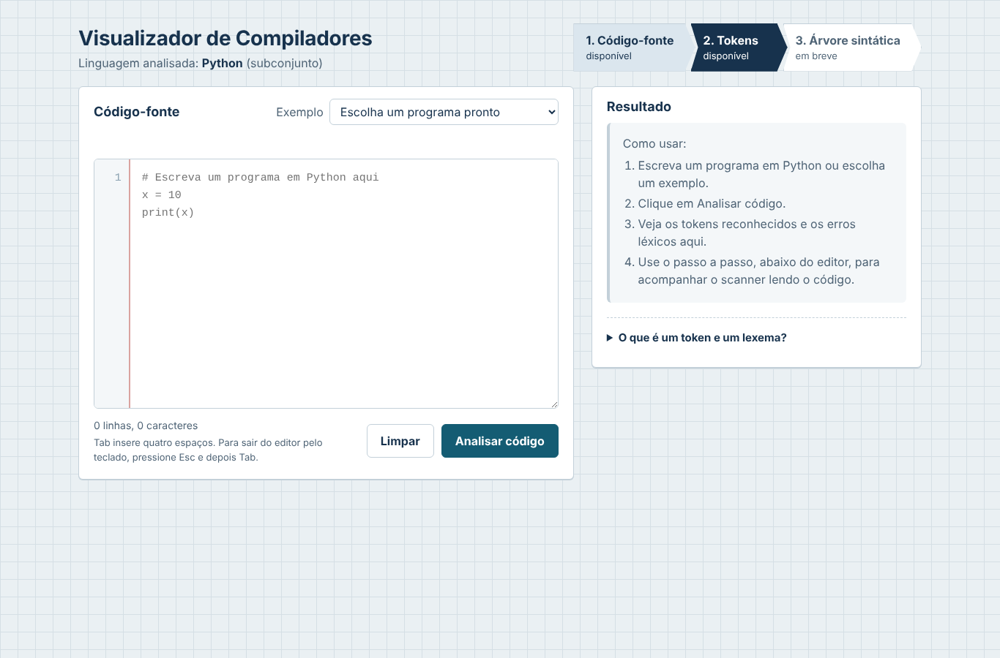
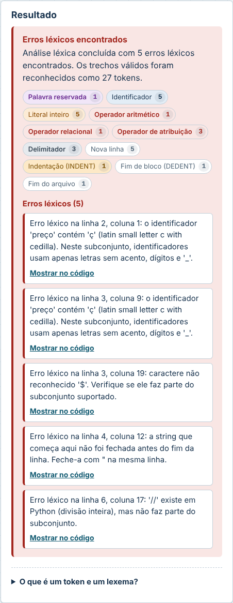

# Tutorial: sua primeira análise léxica

Este roteiro leva cerca de 10 minutos e mostra como usar o Visualizador para entender o que um **scanner** (analisador léxico) faz. Antes de começar, suba a aplicação (`docker compose up --build -d --wait`) e abra **http://localhost:8080**.

## 1. Analise um programa pronto

1. No campo **Exemplo**, escolha **Estrutura condicional**.
2. Clique em **Analisar código**.

O painel **Resultado** informa quantos tokens foram reconhecidos e mostra a contagem por categoria. Abaixo do editor aparece o painel **Análise léxica passo a passo**, com o código colorido e a tabela de tokens.

> **Para pensar:** o programa tem 7 linhas, mas o scanner gerou 41 tokens. De onde vêm tantos?

## 2. Leia o código colorido e a tabela

Cada cor é uma categoria de token (a legenda fica embaixo do código):

- roxo: palavra reservada (`if`, `elif`, `else`);
- azul: identificador (`nota`, `print`);
- laranja: número; verde: string;
- vermelho: operador; cinza: delimitador;
- faixas amarelas: recuo que gerou `INDENT`;
- `↵` marca uma `NOVA_LINHA` e `⇤` marca um `DEDENT`.

A tabela lista os mesmos tokens com **tipo, lexema, linha e coluna**. O lexema é o trecho exato do código; o tipo é a categoria que o scanner atribuiu a ele.

> **Para pensar:** por que `print` aparece como IDENTIFICADOR e não como palavra reservada? (Resposta: em Python 3, `print` é uma função comum.)

## 3. Acompanhe o scanner passo a passo

1. Clique em **⏮** para voltar ao primeiro passo.
2. Use **▶** (ou a seta para a direita do teclado) para avançar um token por vez. Também é possível clicar em **Reproduzir**, arrastar a barra ou clicar em um token do código ou no número dele na tabela.

A cada passo, o token atual fica destacado, o que ainda não foi lido fica esmaecido e uma frase explica a decisão do scanner, por exemplo:

- "Leu 'if': tem a forma de um identificador, mas está na lista de palavras reservadas → PALAVRA_RESERVADA."
- "Leu '>=': o scanner olhou um caractere à frente e escolheu o operador mais longo..."

## 4. Observe a pilha de indentação

Avance até a linha 3 (`    print("Aprovado")`). Repare na **Pilha de indentação**: ela passa de `0` para `0 4`, e o scanner gera um `INDENT`. Na linha 4 (`elif`), o recuo volta a 0: o nível 4 sai da pilha e o scanner gera um `DEDENT`.

> **Exercício:** escolha o exemplo **Repetição com blocos aninhados** e descubra quantos `DEDENT` o scanner gera na linha 8 e por quê.

## 5. Provoque erros léxicos

1. Escolha o exemplo **Erros léxicos** e clique em **Analisar código**.
2. Leia a lista de erros. Cada mensagem diz a linha, a coluna e o motivo.
3. Clique em **Mostrar no código** em um dos erros: o trecho fica selecionado no editor e o passo a passo vai até ele.

Repare que o scanner **não para no primeiro erro**: ele pula o trecho inválido e continua, então os tokens válidos continuam na tabela.

> **Exercício:** corrija os erros um por um (troque `preço` por `preco`, apague o `$`, feche as aspas e troque `//` por `/`) e analise de novo a cada correção.

## 6. Erro léxico × erro sintático

Escolha o exemplo **Erro sintático (tokens válidos)**. Falta o `:` depois de `if x > 5`, mas a análise léxica termina **sem erros**: todos os lexemas são tokens válidos. O problema está na **ordem** dos tokens, e quem verifica a ordem é a análise sintática, que será implementada na Etapa 4.

## 7. Experimente

Algumas ideias para escrever no editor:

| Escreva | O que observar |
| --- | --- |
| `x = 3.` | número real incompleto |
| `if x>=1:` (sem espaços) | o scanner separa os tokens mesmo sem espaços |
| `y = 2 ** 3` | operador de Python fora do subconjunto |
| `for i in x:` | aviso: palavra reservada fora do subconjunto |
| um bloco recuado com 2 espaços e outro com 4 | erro de indentação inconsistente |
| `print("a",` e uma quebra de linha antes de `"b")` | dentro de parênteses a quebra de linha não gera `NOVA_LINHA` |

A lista completa de categorias, decisões e erros está em [`escopo-lexico.md`](escopo-lexico.md).
